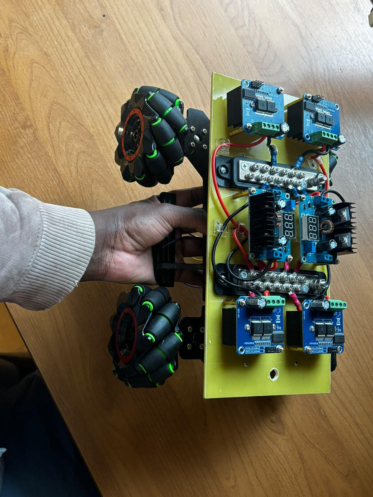
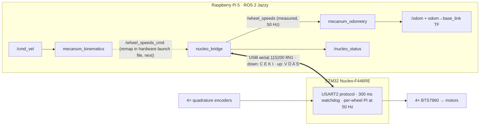

# Mecanum Wheel Mobile Robot Project

**A four-wheel mecanum-drive robot that drives under its own battery power today, with per-wheel closed-loop velocity control running on all four wheels, and wheel-speed commands coming from ROS 2 on a Raspberry Pi 5 through a bench-verified serial bridge.**

Most "autonomous robot" portfolio projects stop at Gazebo. This one doesn't: the physical robot has driven under battery power with wheels off the ground, all four BTS7960-driven motors commanded through a real mecanum mixer, and all four quadrature encoders confirmed reading live on hardware. It now takes wheel-speed commands from ROS 2 on a Raspberry Pi 5 through the `nucleo_bridge` serial-bridge node, bench-verified wheels up. The ROS 2 stack — inverse/forward kinematics, dead-reckoning odometry, and a full Gazebo Harmonic simulation validated to 9 significant figures against the robot's own math — is built and tested in parallel, targeting Nav2 autonomous navigation once the hardware launch file, sensor fusion, and SLAM land.

The system splits across two boards by responsibility:

- **STM32 Nucleo-F446RE**: the real-time layer. Deterministic PWM generation, quadrature encoder reading, a hardware-verified serial command interface with a command watchdog, and closed-loop wheel velocity control (per-wheel PI control: feedforward + P + clamped integral, bench-verified on all four wheels), with no OS in the way.
- **Raspberry Pi 5** — the perception and autonomy layer, running ROS 2 Jazzy: the serial bridge to the Nucleo, kinematics, odometry, sensor fusion, SLAM, and Nav2.

The two boards talk over USB serial (USART2 on the Nucleo side, through the ST-Link virtual COM port) via the `nucleo_bridge` ROS 2 node. The protocol is hardware-verified from both ends: first against the Mac Python tools, then with the ROS 2 node on the Pi ([bench results](ros2_ws/bench/2026-11-01_nucleo_bridge/)). See [System Architecture](#system-architecture) for the full breakdown.

## Project Overview

This project implements a mecanum wheel mobile robot capable of:
- Omnidirectional movement (forward, backward, lateral, diagonal)
- Rotation in place
- Simultaneous translation and rotation
- LiDAR-based mapping and autonomous navigation (planned)

The build follows a two-deck chassis: Deck 1 carries the power distribution layer (complete), and Deck 2 will carry the compute and sensing layer (in progress). Firmware and ROS 2 software are developed incrementally through a structured phase-based approach.

---

## Demo

**First powered drive** — all four wheels driven forward under battery power, wheels off the ground, all four encoders confirmed reading live on the debugger.

https://github.com/user-attachments/assets/70353340-a9e4-4cdd-b505-c8343d9dc1bf

**Encoder velocities on the debugger** — live per-wheel velocity readouts via STM32 Live Expressions, confirming the forward-positive sign convention on hardware.

https://github.com/user-attachments/assets/f964e577-ef93-403b-8885-005ee88034cf

---

## Current Status

### Hardware Build

| Stage | Description | Status |
|-------|-------------|--------|
| H1 | Chassis frame assembly | ✅ Complete |
| H2 | Motor and wheel mounting | ✅ Complete |
| H3 | Deck 1 – Power wiring (bus bars, fuse, BTS7960, bucks) | ✅ Complete |
| H4 | Control-side wiring (encoder signal wires + BTS7960 logic connections, continuity-checked) | ✅ Complete |
| H5 | Deck 2 – Compute and sensing layer mounting | 🔄 In Progress |
| H6 | Full system integration and cable management | ⏳ Planned |

### Firmware (STM32 Nucleo-F446RE)

| Stage | Description | Status |
|-------|-------------|--------|
| F1 | Bring-up: GPIO LED blink, PWM LED fade, single-motor BTS7960 test | ✅ Complete |
| F2 | Full 4-motor mecanum drive — `mecanum_drive()` / `motor_set()`, 8 PWM channels on TIM3/TIM4 @ 1 kHz | ✅ Complete |
| F3 | All four wheel encoders read via hardware quadrature timers (TIM1, TIM8, TIM5, TIM2); 50 Hz velocity computed via a TIM6 interrupt | ✅ Complete |
| F4 | Forward-positive per-wheel sign convention, verified on hardware | ✅ Complete |
| F5 | Disarm-at-boot safety layer (`motors_arm()` gate, duty-cycle ceiling), hardware-verified with the debugger | ✅ Complete |
| F6 | First powered drive — all four wheels under battery, all four encoders confirmed live | ✅ Complete |
| F7 | Serial protocol over USART2, tested against a Mac Python script | ✅ Complete |
| F8 | Command watchdog | ✅ Complete |
| F9 | Closed-loop velocity control, piece 2: per-wheel P control with a live `K` gain command, bench-verified on all four wheels ([results](firmware/stm32/nucleo_f446re/bench/2026-10-12_p_control/)) | ✅ Complete |
| F10 | Integral action (PI): `I` gain command, ±60 windup clamp, reset on disarm and at zero target, `D` integral telemetry; Kp 10 / Ki 100 bench-verified on all four wheels ([results](firmware/stm32/nucleo_f446re/bench/2026-10-19_pi_control/)) | ✅ Complete |

### ROS 2 (Raspberry Pi 5, `ros2_ws/`)

| Stage | Description | Status |
|-------|-------------|--------|
| R1 | Package scaffolding — `mecanum_bringup`, `mecanum_description`, `mecanum_interfaces`, `mecanum_control` | ✅ Complete |
| R2 | `mecanum_kinematics` node — inverse kinematics, `/cmd_vel` → `/wheel_speeds` | ✅ Complete |
| R3 | `mecanum_odometry` node — forward kinematics, dead-reckoning odometry, publishes `/odom` and the `odom`→`base_link` TF | ✅ Complete |
| R4 | Gazebo Harmonic simulation — headless, `ros_gz` bridge; kinematics/odometry validated against the simulator to 9 significant figures; visualized in Foxglove | ✅ Complete |
| R5 | Nucleo serial-bridge node `nucleo_bridge`: 100 ms heartbeat, stale-command zeroing, ramp limit, confirmed start-up handshake, measured speeds on `/wheel_speeds`, board state on `/nucleo_status`; 25 pytest cases, bench-verified wheels up on 2026-10-30 and 2026-11-01 ([node](ros2_ws/src/mecanum_control/mecanum_control/nucleo_bridge.py) · [tests](ros2_ws/src/mecanum_control/test/test_nucleo_bridge.py) · [config](ros2_ws/src/mecanum_bringup/config/nucleo_bridge.yaml) · [results](ros2_ws/bench/2026-11-01_nucleo_bridge/)) | ✅ Complete |
| R6 | IMU fusion via `robot_localization` | ⏳ Planned |
| R7 | RPLIDAR `/scan` integration | ⏳ Planned |
| R8 | SLAM (`slam_toolbox`) | ⏳ Planned |
| R9 | Nav2 autonomous navigation | ⏳ Planned |

---

## Safety Architecture

There is **no physical e-stop button** on this robot — that hardware was deliberately dropped in favor of a layered electrical/firmware approach instead:

1. **Physical kill — XT60 battery disconnect.** Unconditional, always available: pull the connector and every driver loses power.
2. **Automatic kill — firmware command watchdog.** If the command stream over the serial link goes quiet for 300 ms, the Nucleo disarms itself: PWM zeroes and the command targets clear. Arming is explicit and latching — only an `E,1` command arms the board (`E,0` disarms it), so a flickering link can't silently re-arm a moving robot. `S,ARMED` / `S,DISARMED` / `S,TIMEOUT` status lines report the state, and the green LD2 LED is the armed indicator. This layer is hardware-verified over USB, and the 300 ms timeout was kill-tested wheels-up under battery power on 2026-10-12 (stop judged by eye, not logged). The watchdog is now also fed by the serial bridge's 100 ms heartbeat, and it backed up the bridge in the `kill -9` tests on 2026-10-30 and 2026-11-01: the wheels stopped and the latch held.
3. **Deliberate kill — explicit disarm.** The board boots disarmed: all four BTS7960 enable pins are held low at startup, and an explicit `motors_arm()` call is required before any PWM reaches the drivers. Disarming drops the enable pins **and** zeros the PWM duty registers. A duty-cycle ceiling (300 of 999) also caps speed during development. This layer is implemented and hardware-verified with the debugger today.

On the host side, `nucleo_bridge` adds its own guards: a wheel command older than 0.5 s is replaced by zeros, so a dead upstream node stops the wheels instead of the heartbeat hiding it; the node refuses to arm unless every reply in its start-up handshake arrives; it sends an explicit stop (`C,0,0,0,0`, then `E,0`) on exit; and a lost serial link ends it with one clean error line and exit code 1 ([bench results](ros2_ws/bench/2026-11-01_nucleo_bridge/)).

---

## Build Log

### Deck 1 – Power Wiring ✅ Complete

**Goal:** Wire all power components on Deck 1 following a star topology so every consumer gets a clean, independently fused feed from the central bus bars.

**What was done:**
- Mounted 4× BTS7960 motor drivers (one per wheel: FL, FR, RL, RR)
- Mounted 2× XL4016E1 buck converters (Buck A and Buck B)
- Installed positive and negative bus bars as the central power distribution point
- Wired XT60 battery connector → inline fuse → positive bus bar
- Star-wired all BTS7960 PWR inputs and both buck converter inputs from the bus bars
- Adjusted and verified output voltages with a multimeter (the multimeter reading is treated as ground truth, not the buck modules' onboard displays):
  - **Buck A → 5.00 V** (STM32 Nucleo supply)
  - **Buck B → 5.10 V** (Raspberry Pi 5 supply)

**Result:** Deck 1 power wiring complete and tested. All voltages verified. Ready for Deck 2 assembly.

| Isometric view | Top-down view |
|:-:|:-:|
|  |  |

---

### Control-Side Wiring ✅ Complete

**Goal:** Get every signal wire between Deck 1's drive electronics and the Nucleo in place and verified, ahead of Deck 2 going on top.

**What was done:**
- Ran all four encoder signal wires from the motors to the Nucleo
- Wired all four BTS7960 logic connections — RPWM, LPWM, R_EN, L_EN per driver
- Tied a common logic ground across all four drivers and the Nucleo GND
- Continuity-checked every connection

**Result:** The Nucleo now has everything it needs, electrically, to drive all four motors and read all four encoders — confirmed by the first powered drive below.

---

### Deck 2 – Compute and Sensing Layer 🔄 In Progress

**Goal:** Mount and connect all compute and sensing components on Deck 2.

**Planned components:**
- Raspberry Pi 5 (compute)
- STM32 Nucleo-F446RE (motor firmware)
- RPLIDAR C1 (360° LiDAR)
- MPU-9250 IMU (inertial measurement)
- Pass-through grommets for encoder and driver logic cables from Deck 1

**Status:** Hole layout planned and drilling guide prepared. Mounting not yet started.

---

## Roadmap to Completion

Two tracks can proceed largely in parallel — firmware software work doesn't need Deck 2 mounted, since Deck 1 and the control-side wiring already give the Nucleo everything it needs.

| Stage | Description | Depends on |
|-------|-------------|------------|
| 1 | Serial protocol over USART2, validated against a Mac Python test script | Firmware track — complete |
| 2 | Command watchdog (automatic kill on lost link) | Stage 1 — complete |
| 3 | Closed-loop velocity control: P and PI complete and bench-verified | Stage 2, complete |
| 4 | Deck 2 mounting (Raspberry Pi 5, RPLIDAR C1, IMU) | Hardware track — in progress now |
| 5 | Full cable management and system integration | Stage 4 |
| 6 | ROS 2 Nucleo serial-bridge node: complete and bench-verified wheels up | Stages 1 to 3, complete (done on the bench ahead of stage 5) |
| 7 | IMU fusion via `robot_localization` | Stage 6 |
| 8 | RPLIDAR `/scan` integration + SLAM (`slam_toolbox`) | Stage 6 |
| 9 | Nav2 autonomous navigation | Stages 7 and 8 |

---

## Hardware Components

### Compute and Control

| Component | Part | Notes |
|-----------|------|-------|
| Main compute | Raspberry Pi 5 (8 GB) | Runs ROS 2, SLAM, Nav2 |
| Microcontroller | STM32 Nucleo-F446RE | ARM Cortex-M4, 180 MHz, 512 KB Flash |
| IMU | MPU-9250 | I2C interface |
| LiDAR | RPLIDAR C1 | 360° scanning, USB interface |

### Power System

| Component | Part | Notes |
|-----------|------|-------|
| Battery | 3S LiPo (~11.1 V nominal) | XT60 connector |
| Inline fuse | 30 A | Battery-side protection |
| Bus bars | Positive + negative | Star topology distribution point |
| Buck A | XL4016E1 | Set to 5.00 V → STM32 Nucleo |
| Buck B | XL4016E1 | Set to 5.10 V → Raspberry Pi 5 |

### Drive System

| Component | Part | Quantity |
|-----------|------|---------|
| Motor drivers | BTS7960 | 4× (one per wheel) |
| Motors | TSINY-8370 DC with encoder | 4× |
| Wheels | Mecanum wheels | 4× |

---

## Robot Geometry

```
        Front
   FL ──────── FR
    |           |
    |  lx   lx  |
    |           |
   RL ──────── RR
        Rear
```

| Parameter | Value |
|-----------|-------|
| Wheel-contact layout | 200 × 200 mm square |
| Wheel radius (r) | 0.0483 m (caliper-measured, confirmed) |
| Half-wheelbase (lx) | 0.1 m |
| Half-track (ly) | 0.1 m |
| Kinematic origin | Centre of the wheel rectangle; `base_link` sits at ground level at this centroid |

Wheel naming: **FL** (front-left), **FR** (front-right), **RL** (rear-left), **RR** (rear-right).

---

## Project Structure

```
.
├── firmware/               # Microcontroller firmware
│   ├── stm32/
│   │   └── nucleo_f446re/
│   │       ├── led_blink/        # Bring-up phase
│   │       ├── pwm_led_fade/     # Bring-up phase
│   │       ├── mecanum_drive/    # Active project: full 4-motor mecanum drive,
│   │       │                     # 4-wheel quadrature encoder reading, and the
│   │       │                     # disarm-at-boot safety layer
│   │       ├── tools/            # Host-side serial, logging and plotting scripts
│   │       └── bench/            # Dated bench sessions: raw CSVs, plots, write-ups
│   ├── esp32/
│   ├── arduino/
│   └── drivers/
├── ros2_ws/                # ROS 2 Jazzy colcon workspace (runs on the Raspberry Pi 5)
│   ├── bench/                    # Dated bench sessions: raw CSVs, plots, write-ups
│   └── src/
│       ├── mecanum_bringup/      # Launch files and config, including headless
│       │                         # Gazebo Harmonic simulation bring-up; config/
│       │                         # includes nucleo_bridge.yaml
│       ├── mecanum_description/  # Robot URDF (xacro) + display.launch.py
│       ├── mecanum_interfaces/   # Custom msg/srv/action definitions
│       └── mecanum_control/      # mecanum_kinematics, mecanum_odometry,
│                                 # joint_state_adapter (sim) and
│                                 # nucleo_bridge (hardware) nodes
├── hardware/               # Hardware documentation
│   ├── cad/                # CAD files and 3D models
│   ├── schematics/         # Electrical schematics
│   ├── bom/                # Bill of materials
│   └── datasheets/         # Component datasheets
├── docs/                   # Documentation
│   ├── user-guide/         # User guides and development log
│   ├── videos/             # Demo videos
│   │   └── stm32/          # STM32 phase test recordings
│   └── images/             # Documentation images
│       ├── stm32/          # STM32 phase photos
│       └── hardware/       # Hardware build photos
├── config/
├── tests/
└── scripts/
```

---

## System Architecture

The project splits into two independently-running parts that talk to each other over a USB serial link:

- **`firmware/`**: runs on the STM32 Nucleo-F446RE. Handles the real-time layer: 8-channel PWM generation for all four motors, quadrature encoder reading and velocity computation for all four wheels, the disarm-at-boot safety gate, and (as of Phase F7) the USART2 serial link to the Raspberry Pi (newline-framed ASCII: `C,fl,fr,rl,rr` velocity commands in rad/s, `E,1`/`E,0` arm and disarm, `K,<kp>` proportional gain, `I,<ki>` integral gain, `V,...` telemetry streamed at 50 Hz, `D,...` integral telemetry sent after each `V` line, `A,...` acknowledgements), with the Phase F8 command watchdog layered on top. Host-side tooling lives in `firmware/stm32/nucleo_f446re/tools/`: `serial_monitor.py` and `serial_console.py` for interactive testing, `step_logger.py` and `plot_step.py` for logging and plotting wheel step responses, and `i_check.py`, a USB-only protocol check that needs no motor power. Dated bench sessions with raw data, plots and write-ups live in `firmware/stm32/nucleo_f446re/bench/`: the [2026-10-12 P-control sweep](firmware/stm32/nucleo_f446re/bench/2026-10-12_p_control/) and the [2026-10-19 PI-control session](firmware/stm32/nucleo_f446re/bench/2026-10-19_pi_control/). ROS 2-side bench sessions live in `ros2_ws/bench/`: the [2026-10-30 and 2026-11-01 Nucleo serial-bridge session](ros2_ws/bench/2026-11-01_nucleo_bridge/).
- **`ros2_ws/`** — a ROS 2 Jazzy colcon workspace that runs on the Raspberry Pi 5. Currently holds four packages:
  - `mecanum_bringup` — launch files and configuration, including the headless Gazebo Harmonic simulation bring-up.
  - `mecanum_description` — the robot's URDF, built from measurements taken off the physical robot. `base_link` sits at ground level, at the centroid of the 200×200 mm wheel-contact square. `display.launch.py` brings up `robot_state_publisher` and `joint_state_publisher` for visualizing the model.
  - `mecanum_interfaces` — custom interfaces (`WheelSpeeds.msg`, `ResetOdometry.srv`, `MoveForSeconds.action`) shared between nodes.
  - `mecanum_control` — the `mecanum_kinematics` node (inverse kinematics, `/cmd_vel` → `/wheel_speeds`) and the `mecanum_odometry` node (forward kinematics, dead-reckoning odometry, `/odom` and the `odom`→`base_link` TF). Both are validated in a headless Gazebo Harmonic simulation via the `ros_gz` bridge, to 9 significant figures against the simulator, and visualized in Foxglove. In simulation, `joint_state_adapter` reshapes Gazebo's joint states into measured wheel speeds on `/wheel_speeds`. On the real robot, the `nucleo_bridge` node owns the Nucleo serial port (`/dev/ttyACM0`, 115200 8N1). It re-sends the latest `/wheel_speeds_cmd` as a `C` line every 100 ms (the heartbeat for the firmware's 300 ms watchdog), replaces a command older than 0.5 s with zeros, limits the change to 2.0 rad/s per line (20 rad/s²), and clamps speeds to 41.9 rad/s, just under the firmware's 42 rad/s limit. It publishes every measured `V` line (50 Hz) on `/wheel_speeds`, the same contract `joint_state_adapter` fills in simulation, so `mecanum_odometry` runs unchanged, and the board state (`ARMED` / `DISARMED` / `TIMEOUT`) on `/nucleo_status` with transient-local durability. Parameters load from `mecanum_bringup/config/nucleo_bridge.yaml`. Still to come: `mecanum_kinematics` publishes on `/wheel_speeds` and the bridge listens on `/wheel_speeds_cmd`, so nothing connects them yet. The hardware launch file that remaps them is the next step; on the bench, the bridge was driven by publishing `/wheel_speeds_cmd` directly with `ros2 topic pub`.

  `ros2_ws/` has its own `.gitignore` for `build/`, `install/`, and `log/`. An earlier workspace, `mecanum_actions_ws`, is retained only as a ROS 2 fundamentals learning archive — it is not part of the active system.

Data flow on the real robot (the dashed edge is the remap still to come):



---

## Mecanum Wheel Kinematics

The mecanum wheel configuration allows for omnidirectional movement through independent control of each wheel's velocity.

| Movement      | FL  | FR  | RL  | RR  |
|---------------|-----|-----|-----|-----|
| Forward       | +   | +   | +   | +   |
| Backward      | -   | -   | -   | -   |
| Strafe Left   | -   | +   | +   | -   |
| Strafe Right  | +   | -   | -   | +   |
| Rotate CW     | +   | -   | +   | -   |
| Rotate CCW    | -   | +   | -   | +   |

### PWM Motor Control

Each motor is controlled via a BTS7960 driver using two PWM channels:
- **RPWM**: Forward direction
- **LPWM**: Reverse direction
- **Duty cycle**: 0–999 steps (1000 resolution levels), capped at 300 during development by the safety layer
- **PWM frequency**: 1 kHz for development, 20 kHz for production (reduces audible noise)
- **Timer source**: TIM3/TIM4 on APB1 at 90 MHz, prescaler 89 (1 MHz tick), ARR/period 999, giving 1 kHz PWM

---

## Getting Started

### Prerequisites

- [STM32CubeIDE 2.0](https://www.st.com/en/development-tools/stm32cubeide.html)
- [STM32CubeMX 6.16.1](https://www.st.com/en/development-tools/stm32cubemx.html)
- ST-LINK Server (required on macOS for flashing)
- STM32Cube FW_F4 V1.28.3 firmware package
- USB cable for ST-LINK/V2-1 on-board debugger
- Raspberry Pi 5 running Ubuntu 24.04 LTS with ROS 2 Jazzy, for the `ros2_ws/` side (the Gazebo Harmonic simulation runs headless in GitHub Codespaces, not on the Pi)

### Installation

1. Clone the repository:
   ```bash
   git clone https://github.com/KamalaIssack/Mecanum-wheel-mobile-robot-project.git
   ```

2. **Firmware:** Open STM32CubeIDE and import the `mecanum_drive` project from `firmware/stm32/nucleo_f446re/`. Use STM32CubeMX to regenerate peripheral configuration code if needed, then build and flash to the Nucleo-F446RE via the on-board ST-LINK debugger.

3. **ROS 2 (Raspberry Pi 5):**
   ```bash
   cd ros2_ws
   colcon build
   source install/setup.bash
   ```

4. **Run the serial bridge (real hardware):** your user must be in the `dialout` group to open `/dev/ttyACM0`, and the robot should be on its stand, wheels up, for first runs.
   ```bash
   ros2 run mecanum_control nucleo_bridge --ros-args --params-file "$(ros2 pkg prefix mecanum_bringup)/share/mecanum_bringup/config/nucleo_bridge.yaml"
   ```
   Run the tests from `ros2_ws`:
   ```bash
   colcon test && colcon test-result --verbose
   ```

### Development Workflow

1. Configure peripherals in STM32CubeMX (`.ioc` file)
2. Generate code (placed within `/* USER CODE BEGIN/END */` blocks to survive regeneration)
3. Build in STM32CubeIDE
4. Flash via ST-LINK

---

## Working Practices

- **Star topology**: Every power consumer connects directly to the bus bars, never daisy-chained
- **Voltage verification**: A multimeter reading is treated as ground truth for buck output voltage — not a buck module's onboard display — checked after any adjustment before powering compute boards
- **Arm before motion**: The board always boots disarmed; motors only receive PWM after an explicit `motors_arm()` call, and the development duty-cycle ceiling stays in place until closed-loop control is validated
- **Battery safety**: LiPo never left unattended while charging; inline fuse is the first thing in the positive line
- **User code protection**: All STM32 application code lives inside `/* USER CODE BEGIN/END */` blocks

---

## Technical Notes

- The system uses 8 PWM channels (2 per motor × 4 motors) across TIM3/TIM4
- ROS 2 workspace lives in this repo at `ros2_ws/`. The companion repository `mecanum_actions_ws` is now a ROS 2 fundamentals learning archive and no longer holds production packages.

**Known issues** (the full list is in the [R5 bench write-up](ros2_ws/bench/2026-11-01_nucleo_bridge/#challenges-and-how-they-were-handled)):

- The Nucleo runs on its internal HSI clock, which is about 1.3% fast (visible in the logger row counts). The loop regulates the board's own reading, so a commanded 4 rad/s is really about 4.05 rad/s. Moving to HSE bypass is deliberately parked, not forgotten.
- The Nucleo is powered only through the Pi's USB cable: when the cable was pulled on 2026-11-01, all of its LEDs went off. Before self-powered running, a decision is needed on keeping the motor drivers safe if that link drops: power the Nucleo from Buck A as well, or confirm the BTS7960 inputs are pulled low when undriven.

For detailed firmware development notes, see [`docs/user-guide/stm32-development-log.md`](docs/user-guide/stm32-development-log.md).

---

## Contributing

1. Fork the repository
2. Create a feature branch (`git checkout -b feature/new-feature`)
3. Commit changes (`git commit -am 'Add new feature'`)
4. Push to branch (`git push origin feature/new-feature`)
5. Open a Pull Request

## License

[Add license information]

## Acknowledgments

[Add acknowledgments]
