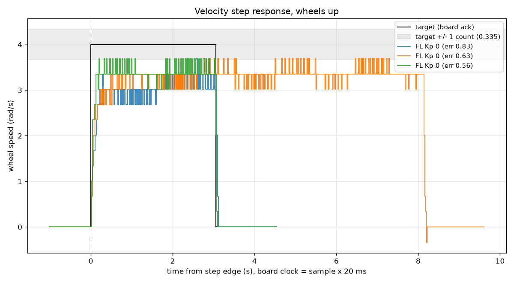
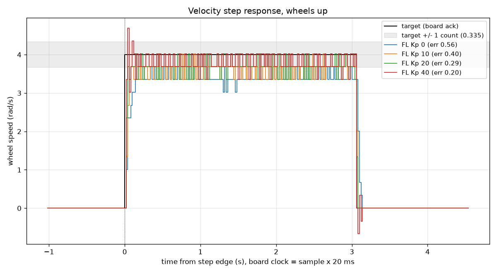
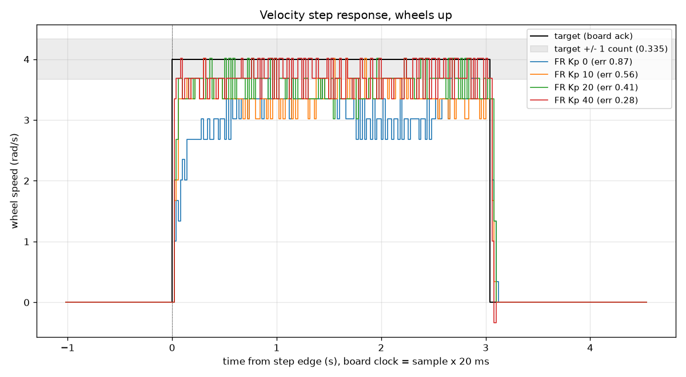
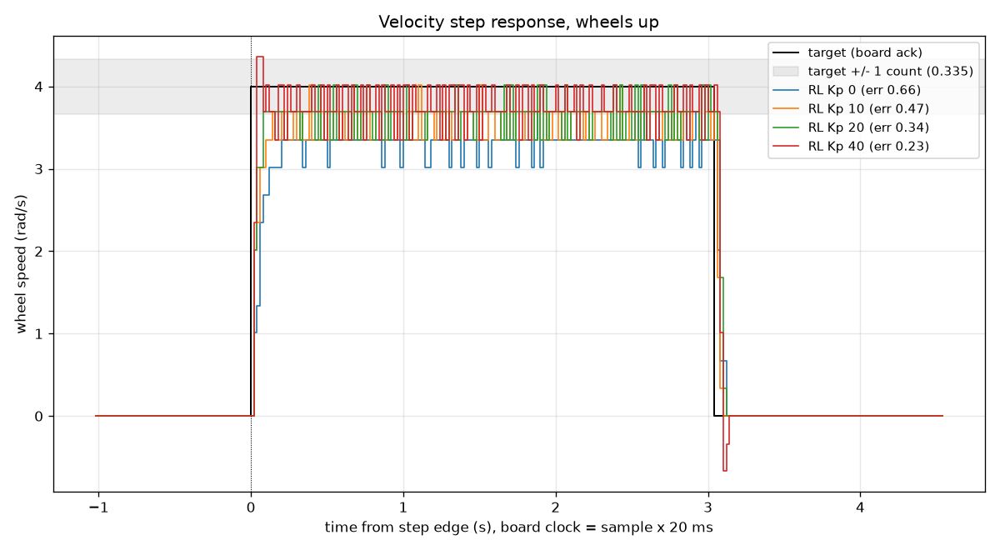
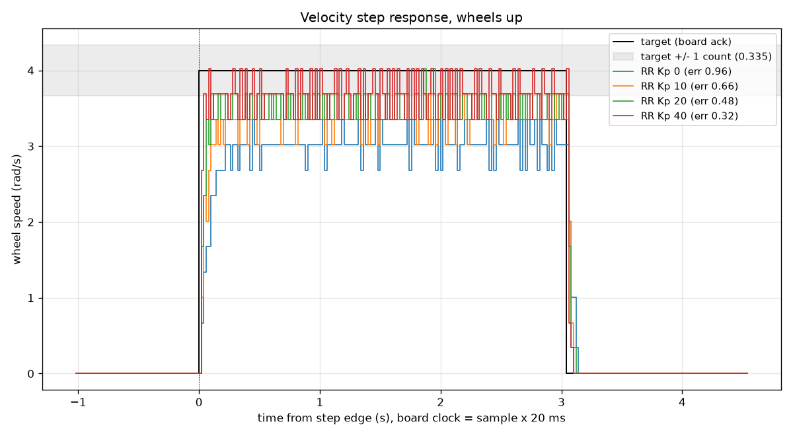
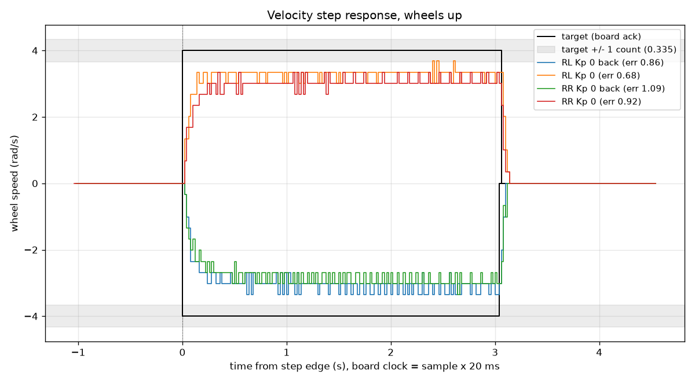
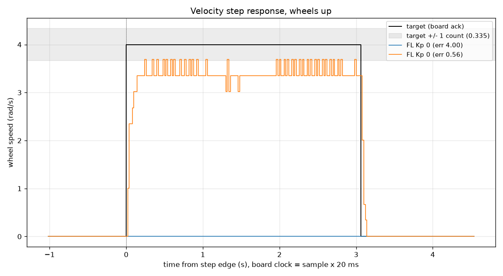

# Step 6 Piece 2: P-only wheel velocity control (2026-10-12)

This bench session tested P-only closed-loop wheel velocity control on all
four wheels (FL, FR, RL, RR), sweeping the proportional gain Kp over 0, 10,
20, and 40, with the robot on a stand and wheels up. Result: raising Kp
reduces steady-state error as predicted, roughly following the proportional
feedback relationship, but it never drives the error to zero. Even at Kp 40
every wheel still falls short of the 4 rad/s target, which is the motivation
for adding integral action in piece 3.

## Setup

- Date: 2026-10-12. Robot on a stand, all four wheels off the ground.
- Power: 3S LiPo, 12.63 V at the start (cells 4.19 / 4.20 / 4.21), about
  12.5 V at the end (cells 4.16 / 4.16 / 4.20). Nucleo powered from USB; the
  buck converters were disconnected for these tests.
- Firmware: commit 3c0b9ff (P-only closed-loop wheel velocity control with
  live K gain command). Tools: commit 4969c64 (step_logger.py / plot_step.py).
- Step profile: 0 -> 4 rad/s -> 0, with a 1 s settle phase, a 3 s hold
  (8 s for the warm-up runs), and a 1.5 s post phase. Telemetry at 50 Hz
  (one line per 20 ms TIM6 tick).
- Control law, per wheel: `duty = 23.85*target + Kp*(target - measured)`,
  clamped to +/-300 of ARR 999.
- Encoder quantization: 937.2 counts/rev, so the velocity measurement moves
  in steps of 1 count per 20 ms tick, which is 0.335 rad/s. A step response
  that is "slow" by less than this amount cannot be distinguished from a
  reading that simply rounded down.
- Table metric definitions (from the `plot_step.py` docstring):
  - **mean**: average speed over the last half of the hold (signed).
  - **error**: how much slower than commanded the wheel ran (+ = too slow,
    in either direction).
  - **jitter**: standard deviation over the same window.
  - **over**: overshoot in whole encoder counts above the highest reading
    the target can produce; 1 count is quantization, 2 or more is real
    overshoot.
  - **t63**: time to reach 63% of the final mean (first-order time
    constant).

## Verification before tuning

- USB-only checks with the motors unpowered: the `K,<value>` gain command
  was acknowledged; malformed or out-of-range commands (`K,300`, `K,-5`,
  `K,3O`, and `K` sent while armed) were all silently rejected. A full dry
  logger run completed with no false watchdog timeout.
- Kp 0 reproduces the earlier open-loop behaviour once the gearbox is warm
  (see `fl_cold_vs_warm.png` below).
- 300 ms watchdog kill test: with all four wheels commanded to 4 rad/s, the
  sending console was killed. The wheels stopped in well under a second,
  judged by eye, not logged. The latch held: a new velocity command was
  acknowledged by the firmware but did not re-arm the wheels.

## Results

| Wheel | Kp | mean (rad/s) | error (rad/s) | jitter (rad/s) | over | t63 (s) |
|-------|----|------|-------|--------|------|------|
| FL | 0  | 3.44 | 0.56 | 0.147 | 0 | 0.04 |
| FL | 10 | 3.60 | 0.40 | 0.179 | 0 | 0.04 |
| FL | 20 | 3.71 | 0.29 | 0.187 | 0 | 0.02 |
| FL | 40 | 3.80 | 0.20 | 0.212 | 2 | 0.02 |
| FR | 0  | 3.13 | 0.87 | 0.273 | 0 | 0.08 |
| FR | 10 | 3.44 | 0.56 | 0.226 | 0 | 0.06 |
| FR | 20 | 3.59 | 0.41 | 0.236 | 0 | 0.04 |
| FR | 40 | 3.72 | 0.28 | 0.261 | 0 | 0.02 |
| RL | 0  | 3.34 | 0.66 | 0.158 | 0 | 0.06 |
| RL | 10 | 3.53 | 0.47 | 0.178 | 0 | 0.04 |
| RL | 20 | 3.66 | 0.34 | 0.219 | 0 | 0.04 |
| RL | 40 | 3.77 | 0.23 | 0.201 | 1 | 0.04 |
| RR | 0  | 3.04 | 0.96 | 0.201 | 0 | 0.10 |
| RR | 10 | 3.34 | 0.66 | 0.153 | 0 | 0.04 |
| RR | 20 | 3.52 | 0.48 | 0.186 | 0 | 0.04 |
| RR | 40 | 3.68 | 0.32 | 0.258 | 0 | 0.02 |

### `plots/fl_cold_vs_warm.png`

This was the day's first run on FL at Kp 0, compared against a later 8 s
warm-up hold and an early-warm run. The cold gearbox ran a full encoder
count per tick slower than the later runs (3.17 rad/s vs 3.44 rad/s) and the
speed stepped up partway through the hold even though duty was held constant
at Kp 0, so the change is in the plant (grease, bearing drag), not in the
control code. After warm-up, FL matched the value seen in the earlier
open-loop testing. Consequence: every wheel block in this session began with
an 8 s warm-up run (the `warmup_*.csv` files) before the Kp sweep.

### `plots/sweep_fl.png`, `plots/sweep_fr.png`, `plots/sweep_rl.png`, `plots/sweep_rr.png`

On all four wheels the error shrinks as Kp rises, consistent with the
proportional relationship `error = e0 / (1 + k*Kp)`, where `e0` is the Kp 0
error and `k` is the incremental gain the controller feels per unit of Kp.
Fitting `k` from each wheel's Kp 10/20/40 runs (`k = (e0/e - 1) / Kp`,
averaged over the three gains) and from that a friction offset
`D_f = 95 - v0/k` (95 is the feedforward duty at 4 rad/s, `v0` is the Kp 0
mean speed):

| Wheel | k (fit) | D_f (fit) |
|-------|---------|-----------|
| FL | 0.044 | 17 |
| FR | 0.055 | 38 |
| RL | 0.045 | 20 |
| RR | 0.048 | 32 |

These are estimates, not exact values; the 0.335 rad/s quantization step
limits how precisely `e0` and `e` can be known, so a result like FL's
`k` = 0.040, 0.047, 0.045 across the three gains spreads by about 15%. `k`
is noticeably larger than the wheel's average gain (speed divided by duty),
because of the friction offset: part of the feedforward duty is spent
overcoming static/rolling friction before it produces any speed, so the
controller's incremental response per unit of error is stronger than the
average response would suggest.

### Overshoot vs plant speed

The four wheels split into two speed groups by their Kp 0 time constant:
FL (t63 0.04 s) and RL (t63 0.06 s) respond fast; FR (t63 0.08 s) and RR
(t63 0.10 s) respond slower. At Kp 40, FL showed 2 counts of overshoot,
which is real (not quantization). RL showed 1 count, which is
indistinguishable from quantization alone. FR and RR showed no overshoot
at any gain. The pattern is consistent with a one-tick (20 ms) measurement
delay in the velocity loop: a faster plant moves further during that delay
before the controller can react, so it overshoots more for the same Kp.

### Jitter

On FL, jitter rises with Kp (0.147 to 0.212 rad/s from Kp 0 to Kp 40):
raising Kp amplifies the quantization noise already present in the velocity
measurement. On FR and RR, jitter dips at Kp 10 (FR: 0.273 to 0.226; RR:
0.201 to 0.153) before rising again at higher Kp. The dip is consistent with
P feedback rejecting these two wheels' slower load wander at a mild gain,
before quantization noise amplification takes over and dominates at higher
Kp.

### Braking at Kp 40

At the end of the hold, the target drops from 4 to 0 rad/s while the wheel
is still running at roughly that speed, so the instantaneous error is about
3.8 rad/s. At Kp 40 that pushes duty to roughly -150 (reverse), well past
zero. FL reversed by 2 counts and rang before settling. RL also reversed by
2 counts, and the stop felt hard (felt and heard at the bench, not
measured). FR reversed by 1 count. RR showed a clean stop with no reversal.
At Kp 40 the spin also sounded rougher than at lower gains: each one-count
flip in the quantized measurement swings duty by about 13 counts (40 *
0.335), which is audible. This suggests a gentler Kp than 40 for day-to-day
use, and that ramped (rather than stepped) velocity commands are worth
considering for a later piece. The stops are visible at about t = 3 s in the
sweep plots above (for example the Kp 40 trace in `plots/sweep_fl.png`).

### `plots/direction_rl_rr.png`

RL and RR were each run forward and backward at Kp 0. Both wheels ran about
0.17 to 0.18 rad/s slower backward than forward (RL: 3.32 forward vs 3.14
backward; RR: 3.08 forward vs 2.91 backward). RL stayed about 0.24 rad/s
faster than RR in both directions (RL 3.32/3.14 vs RR 3.08/2.91). If this
were an electrical-direction effect (e.g. one motor driver phase sequence
behaving differently in reverse), the left and right wheels would be
expected to show opposite signs, since they are mounted mirrored and turn
in opposite electrical directions for the same commanded wheel direction.
Instead both show the same forward-faster pattern, so the left/right speed
split looks like a property of the individual wheel/gearbox units rather
than of direction. The backward traces also crept upward slightly during
the hold, which could be a direction-specific warm-up effect, but this is
tentative: in this session the backward runs always came second (after the
forward run had already warmed the gearbox further), so warm-up and
direction are confounded here.

### `plots/no_motor_power.png`

This plot overlays one of the runs made by mistake with the XT60 unplugged
(`dry_fl_kp0_nobatt.csv`: duty commanded, but no motor power) against a
normal powered FL Kp 0 run. The unpowered trace stays at exactly 0 for the
whole step, yet the logger finished normally and reported the run as
written. That gap is what the logger's planned no-motion check addresses;
see the XT60 item under Challenges below.

## Challenges and how they were handled

- **Cold gearbox on the first run of the day.** The very first FL run
  (`cold_fl_kp0.csv`) ran noticeably slower and changed speed mid-hold at
  constant duty. Handled by adding an 8 s warm-up run before each wheel's Kp
  sweep (`warmup_*.csv`).
- **Three runs made with the XT60 unplugged that the logger reported as
  successful.** `dry_fl_kp0_nobatt.csv`, `dry_fl_kp10_nobatt.csv`, and
  `dry_warmup_fl_nobatt.csv` all logged a full run with every wheel reading
  at zero, with no error from the logger. A no-motion check is written and
  will be committed separately after it has been verified on the bench.
- **Intermittent missing "S,DISARMED" reply.** On 4 of about 25 runs, the
  logger did not see the expected disarm acknowledgment from the board.
  Every case was fixed by simply rerunning. Suspected cause: the first
  command, written immediately after the Mac opened the serial port, was
  lost between macOS and the ST-Link virtual COM port bridge; the board
  itself was running throughout and answered the rerun normally. A settle
  delay plus a single retry of the `E,0` command have been written, pending
  verification on the bench.
- **First version of the plotter mis-reported backward runs and treated
  one-count bumps as overshoot.** This was fixed in commit 4969c64. The PNGs
  drawn on the day by the older plotter were not copied here; every plot in
  this folder was regenerated from the CSVs with the fixed plotter.
- **Watchdog kill test judged by eye only.** The 300 ms stop was not logged;
  "well under a second" is a qualitative, by-eye observation, not a
  measurement.

## Data file index

| Pattern | Contents |
|---------|----------|
| `step_<wheel>_kp<0\|10\|20\|40>_<timestamp>.csv` | The Kp sweep: one run per wheel per gain, 16 files total. |
| `warmup_<wheel>.csv` | 8 s warm-up hold at Kp 0, run before each wheel's sweep. |
| `warmup_fl_kp0_hold8.csv`, `cold_fl_kp0.csv`, `early_fl_kp0_warm.csv` | FL cold-start sequence: first cold run, 8 s warm-up, and an early-warm follow-up, used for the warm-up comparison plot. |
| `warmup_rl_dir.csv` | Warm-up run preceding the RL/RR direction tests. |
| `dir_<rl\|rr>_<fwd\|back>.csv` | Forward/backward runs at Kp 0 for RL and RR. |
| `dry_*_nobatt.csv` | Three runs made by mistake with the XT60 unplugged; the logger reported them as successful. See Challenges. |
| `dry_usb_fl_kp0.csv` | Deliberate USB-only handshake test before the battery was connected (K ack, arm, heartbeat and disarm with no motor power); zeros are expected. |

## Conclusion and next step

P-only control reduces the steady-state error substantially (roughly 2 to
3 times smaller from Kp 0 to Kp 40) but does not remove it: even at Kp 40,
every wheel is still 0.2 to 0.3 rad/s slower than commanded. The four wheels
also split into two distinct families, a faster pair (FL, RL) and a slower
pair (FR, RR), with different incremental gains and friction offsets. Piece
3 will add integral action to drive the steady-state error to zero, with a
windup clamp and a reset on disarm. Whether to use per-wheel gains (rather
than one gain for all four) is left as a tuning decision for piece 3.
