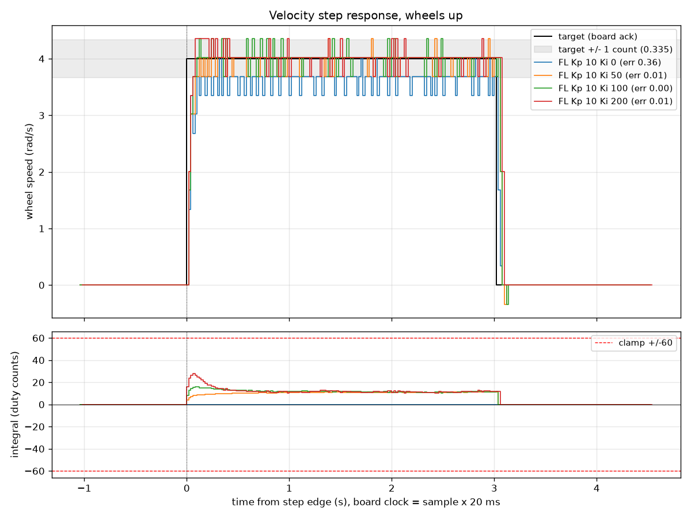
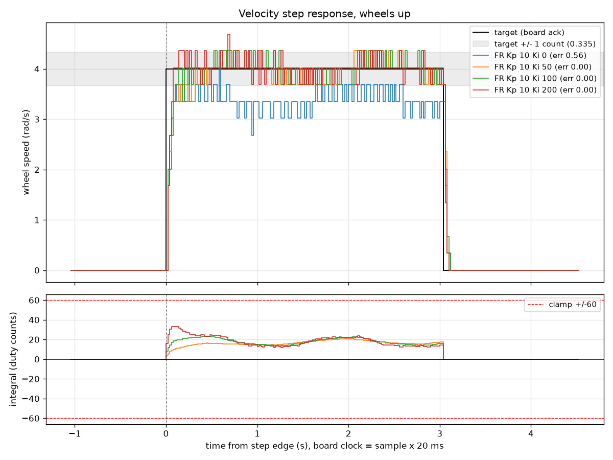
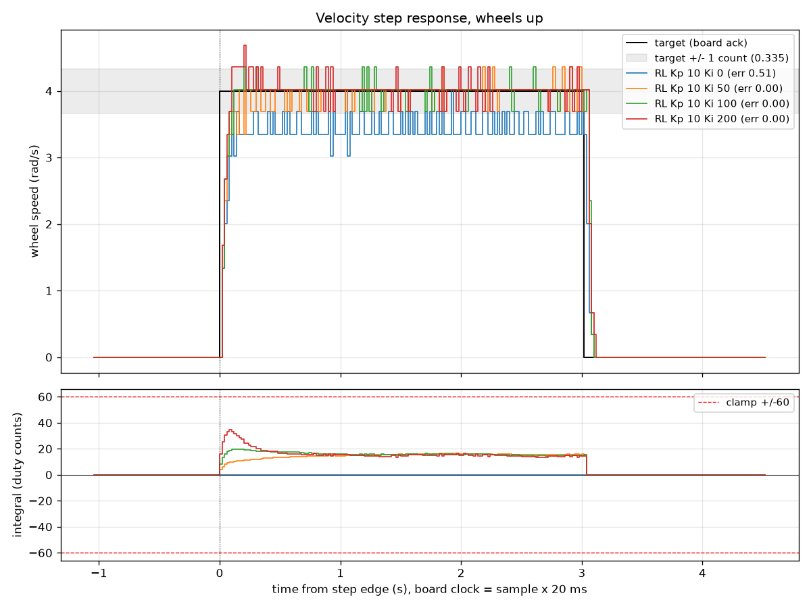
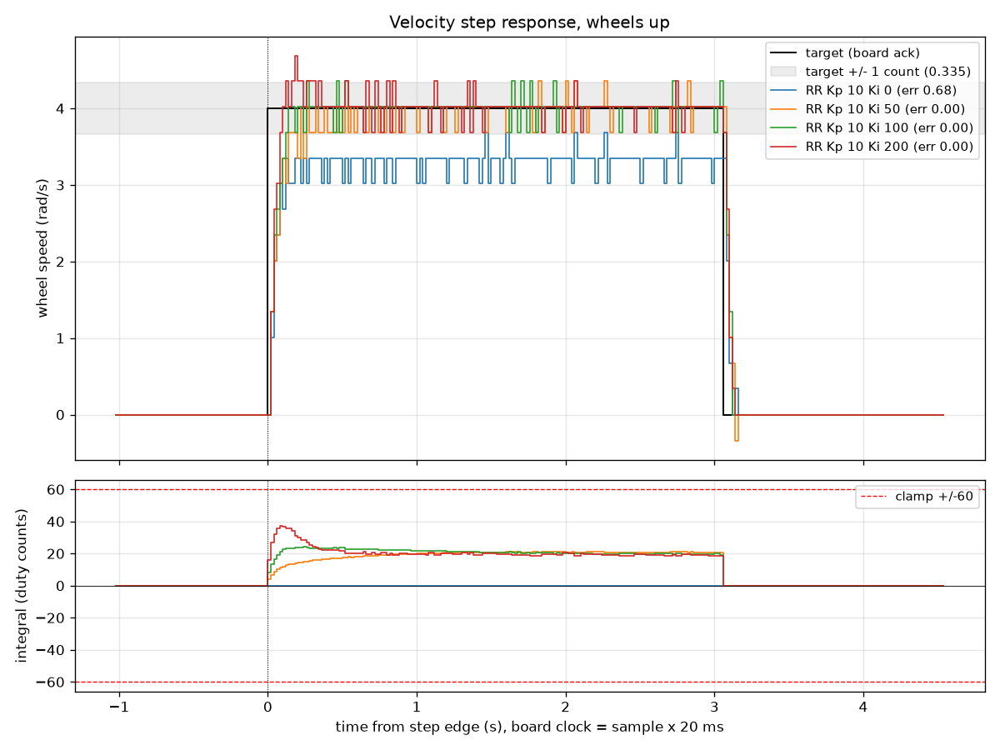
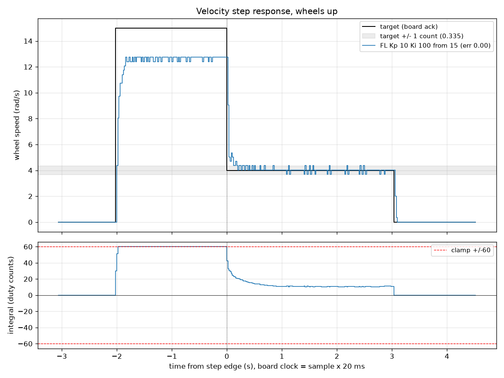
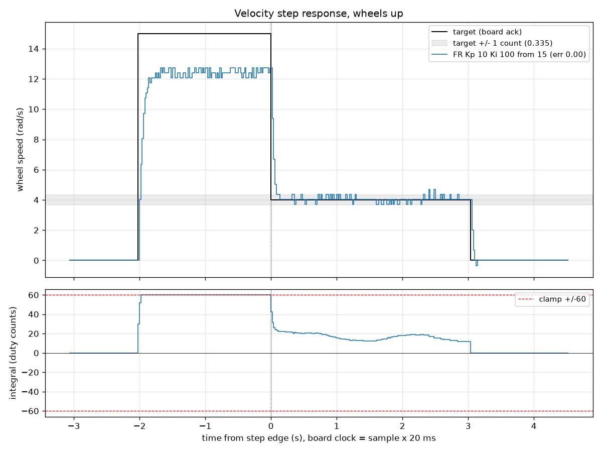
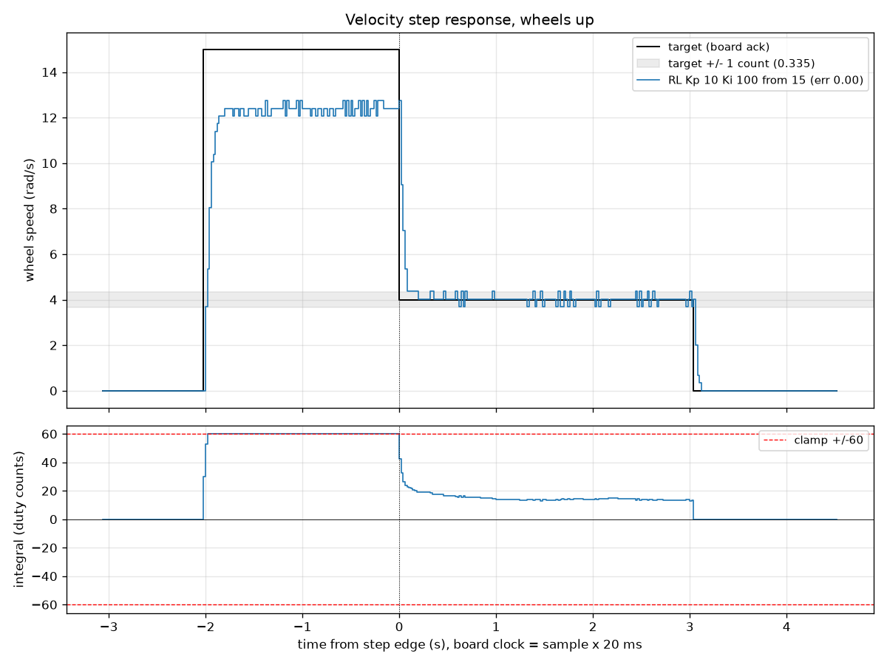
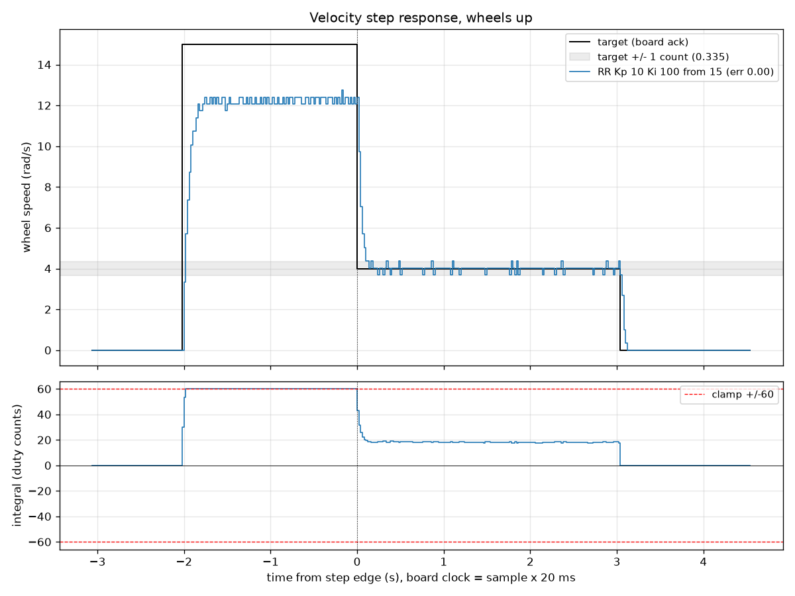
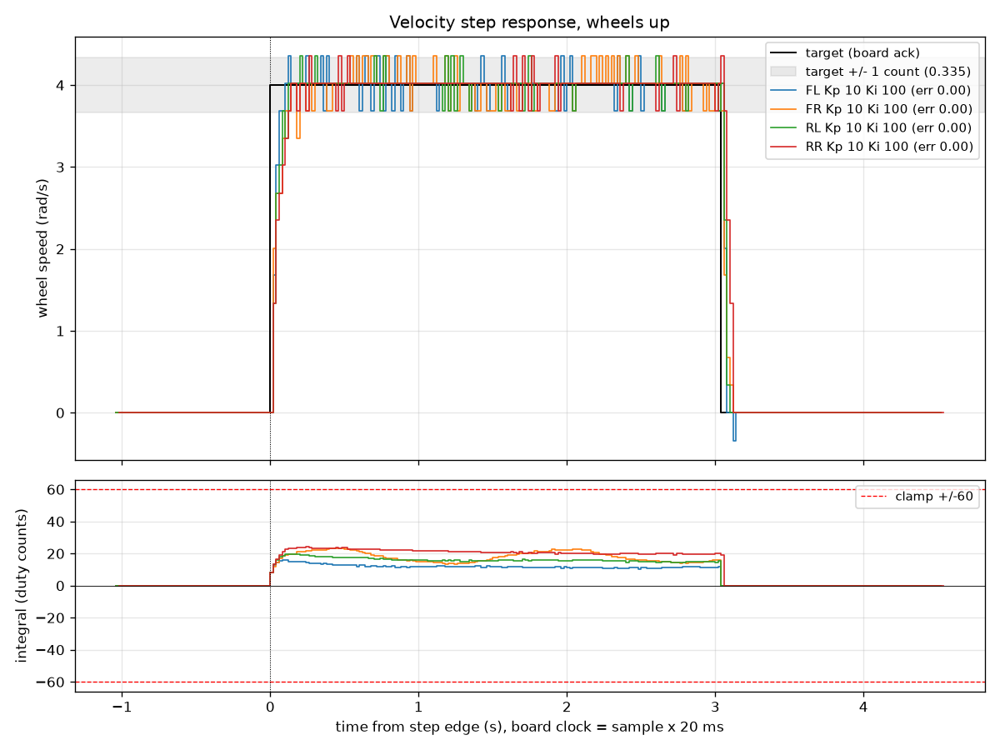
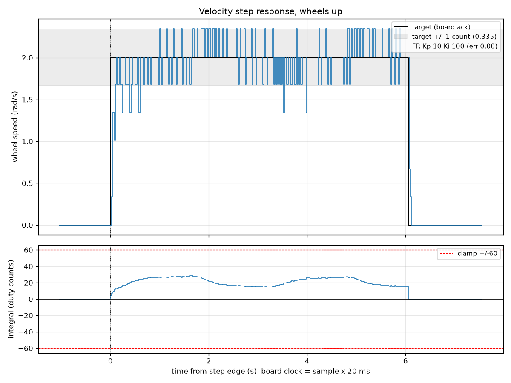

# Step 6 Piece 3: PI wheel velocity control (2026-10-19)

This bench session added integral action to the per-wheel velocity loop and
tested it on all four wheels (FL, FR, RL, RR), with the robot on a stand and
wheels up. The goal was to remove the P-only steady-state error measured on
2026-10-12 (0.40 / 0.56 / 0.47 / 0.66 rad/s at Kp 10 for FL / FR / RL / RR).
Each wheel was run with Ki 0, 50, 100 and 200 at Kp 10, followed by a windup
test. Result: PI control brings the mean error to 0.00 rad/s on every wheel,
Kp 10 / Ki 100 is confirmed as one gain set for all four wheels, and the
+/-60 integral clamp holds windup. Every pass mark set before the session
was met except FR's settling time, which traces to a mechanical drag that
repeats once per wheel revolution, not to the controller.

## Setup

- Date: 2026-10-19. Robot on a stand, all four wheels off the ground.
- Power: 3S LiPo, freshly balance-charged to 12.67 V (cells 4.20 / 4.21 /
  4.22). The pack read 12.64 V at the start of testing (cells 4.19 / 4.20 /
  4.21) and 12.5 V at the end (cells 4.18 / 4.19 / 4.20), measured with a
  UT33D+ multimeter and the cell alarm. The 2026-10-12 P runs were at about
  12.5 to 12.6 V. Nucleo powered from USB.
- Firmware: commit 47b3292 (PI wheel velocity control with integral clamp and
  D telemetry). Tools: commit 70b130b (step_logger.py / plot_step.py /
  i_check.py).
- Warm-up: each wheel's gearbox was run for 8 s at Kp 0 (`--kp 0 --hold 8`)
  immediately before its block, because of the cold-gearbox effect found on
  2026-10-12 (the `warmup_*.csv` files).
- Step profile: 0 -> 4 rad/s -> 0, with a 1 s settle phase, a 3 s hold and a
  1.5 s post phase. Windup runs add a 2 s lead phase at 15 rad/s between the
  settle and the step. Telemetry at 50 Hz (one `V` line and one `D` line per
  20 ms TIM6 tick).
- Control law, per wheel, every tick:
  `e = target - measured`,
  `I = I + Ki*e*0.02`, clamped to +/-60 (I_LIMIT),
  `duty = 23.85*target + Kp*e + I`, clamped to +/-300 of ARR 999.
  The integral is reset to 0 whenever the motors are disarmed or the target
  is 0. It is not reset on a direction reversal: the error there is about
  8 rad/s, so the integral flips sign within about 2 ticks anyway. The +/-60
  clamp was sized from the 2026-10-12 friction model: the largest integral a
  healthy wheel needs at 4 rad/s is about 20, so 60 leaves room for a cold
  gearbox or a sagging battery while bounding windup.
- Encoder quantization: 1 count per 20 ms tick is 0.335 rad/s, and 4 rad/s
  is 11.94 counts per tick, so a wheel tracking 4.0 exactly reads 11 or 12.
- Table metric definitions (from the `plot_step.py` docstring), in addition
  to mean, error, jitter, over and t63 as defined on 2026-10-12:
  - **from**: the speed commanded before the step: 0, or the lead target of
    a windup run.
  - **t_in**: time until the 0.2 s average enters +/-0.1 rad/s of the target
    and stays there for the rest of the hold (n/a = never settled). The
    average is needed because no single reading can sit within 0.1 of 4.0;
    it makes t_in up to 0.2 s pessimistic.
  - **I_ss**: average integral over the same window as mean (duty counts).
  - **gaps**: host-clock gaps over 3 ticks (dropped telemetry lines).

## Verification before tuning

- USB-only protocol check with the XT60 unplugged: `i_check.py` passed 13 of
  13 checks. `I,50` was acknowledged as `A,I,50.00`; `I,500`, `I,-1`,
  `I,abc` and `I,50` sent while armed were all silently rejected; `K,10`
  still worked. In one second armed at target 0, 51 `V` lines and 51 `D`
  lines arrived, every `V` was followed by a `D`, and all integrals read
  0.00.
- No-motion check on hardware: a logger run with the XT60 unplugged (and
  without `--allow-no-motion`) has to fail. It did: the logger stopped after
  76 rows (1 s settle plus 0.5 s), moved the CSV to `logs/failed/` and exited
  with status 1. That file is kept as
  `data/failed/step_fl_kp10_ki100_20261019-170034.csv`.

## Results

Pass criteria were set before the session:

| Check | Pass mark |
|-------|-----------|
| Ki 0 regression | error within +/-0.05 of the 2026-10-12 Kp 10 value |
| Ki 100 mean error | <= 0.05 rad/s |
| Ki 100 overshoot | <= 1 count (1 count is quantization) |
| Ki 100 t_in | < 0.6 s |
| Windup | integral flat at +60 during the lead |
| Gaps | 0 |

| Measured | FL | FR | RL | RR |
|----------|----|----|----|----|
| Ki 0 error (2026-10-12) | 0.36 (0.40) pass | 0.56 (0.56) pass | 0.51 (0.47) pass | 0.68 (0.66) pass |
| Ki 100 error | 0.00 pass | 0.00 pass | 0.00 pass | 0.00 pass |
| Ki 100 overshoot | 1 pass | 1 pass | 1 pass | 1 pass |
| Ki 100 t_in (s) | 0.24 pass | n/a **FAIL** | 0.26 pass | 0.30 pass |
| Windup integral during lead | flat at 60 pass | flat at 60 pass | flat at 60 pass | flat at 60 pass |
| Gaps | 0 pass | 0 pass | 0 pass | 0 pass |

Everything passed except FR's t_in. Its cause is mechanical (see
`plots/fr_diag_2rads.png` below). The pass mark was deliberately not
loosened to make FR pass.

Full plotter output for the session:

| Wheel | Kp | Ki | from | mean | error | jitter | over | t63 (s) | t_in (s) | I_ss |
|-------|----|----|------|------|-------|--------|------|---------|----------|------|
| FL | 10 | 0   | 0  | 3.64 | 0.36 | 0.179 | 0 | 0.04 | n/a  | 0.0   |
| FL | 10 | 50  | 0  | 3.99 | 0.01 | 0.130 | 1 | 0.04 | 0.34 | +11.0 |
| FL | 10 | 100 | 0  | 4.00 | 0.00 | 0.142 | 1 | 0.04 | 0.24 | +11.3 |
| FL | 10 | 200 | 0  | 3.99 | 0.01 | 0.141 | 1 | 0.04 | 0.44 | +11.4 |
| FL | 10 | 100 | 15 | 4.00 | 0.00 | 0.156 | 0 | 0.04 | 0.70 | +10.6 |
| FR | 10 | 0   | 0  | 3.44 | 0.56 | 0.221 | 0 | 0.06 | n/a  | 0.0   |
| FR | 10 | 50  | 0  | 4.00 | 0.00 | 0.208 | 1 | 0.06 | n/a  | +17.9 |
| FR | 10 | 100 | 0  | 4.00 | 0.00 | 0.202 | 1 | 0.04 | n/a  | +18.2 |
| FR | 10 | 200 | 0  | 4.00 | 0.00 | 0.171 | 2 | 0.04 | 2.48 | +17.5 |
| FR | 10 | 100 | 15 | 4.00 | 0.00 | 0.194 | 0 | 0.04 | 2.78 | +15.4 |
| RL | 10 | 0   | 0  | 3.49 | 0.51 | 0.176 | 0 | 0.06 | n/a  | 0.0   |
| RL | 10 | 50  | 0  | 4.00 | 0.00 | 0.166 | 1 | 0.06 | 0.74 | +15.8 |
| RL | 10 | 100 | 0  | 4.00 | 0.00 | 0.120 | 1 | 0.04 | 0.26 | +15.4 |
| RL | 10 | 200 | 0  | 4.00 | 0.00 | 0.166 | 2 | 0.04 | 0.50 | +14.7 |
| RL | 10 | 100 | 15 | 4.00 | 0.00 | 0.179 | 0 | 0.04 | 0.52 | +13.9 |
| RR | 10 | 0   | 0  | 3.32 | 0.68 | 0.141 | 0 | 0.06 | n/a  | 0.0   |
| RR | 10 | 50  | 0  | 4.00 | 0.00 | 0.147 | 1 | 0.08 | 0.94 | +20.8 |
| RR | 10 | 100 | 0  | 4.00 | 0.00 | 0.142 | 1 | 0.06 | 0.30 | +20.0 |
| RR | 10 | 200 | 0  | 4.00 | 0.00 | 0.107 | 2 | 0.04 | 0.48 | +19.2 |
| RR | 10 | 100 | 15 | 4.00 | 0.00 | 0.141 | 0 | 0.06 | 0.28 | +18.1 |

All runs target 4.00 rad/s and had 0 gaps. The FR diagnostic run at 2 rad/s
is reported with its plot below.

### `plots/sweep_fl.png`, `plots/sweep_fr.png`, `plots/sweep_rl.png`, `plots/sweep_rr.png`

Each plot overlays one wheel's four runs at Kp 10 with Ki 0, 50, 100 and 200.
The top panel is wheel speed with the target and a grey +/-1 count band; the
bottom panel is the integral term in duty counts, with the +/-60 clamp drawn
in red. The Ki 0 run sits a full count below the target for the whole hold:
that is the 2026-10-12 problem, reproduced within 0.05 rad/s on every wheel.
Every PI run instead settles on 4.0 by alternating 11 and 12 encoder counts,
which is as close as this encoder can resolve.

- **Ki 200** overshoots in the integral: it peaks at about 28 (FL), 33 (FR),
  34 (RL) and 37 (RR) before settling to 11 to 20, and it produces a real
  2-count speed spike on FR, RL and RR.
- **Ki 50** settles slowly (t_in 0.34 to 0.94 s), because the integral
  takes longer to build up the extra duty each wheel needs.
- **Ki 100** settled fastest on every wheel apart from FR (0.24 / 0.26 /
  0.30 s on FL / RL / RR) and had the lowest or near-lowest jitter.

Kp 10 / Ki 100 is therefore confirmed as the single gain set.

**The integral as a wheel-health gauge.** The P-only error and the settled
integral are two independent measurements of each wheel's friction. With
the 2026-10-12 friction model `v = k*(D - D_f)` and its `k` values, each can
be converted into a friction offset `D_f`. From the Ki 0 error at Kp 10,
`e = (4 - k*(95.4 - D_f)) / (1 + 10*k)`; from the settled integral, the
extra duty needed for zero error is `I = D_f + 4/k - 95.4` (95.4 is the
feedforward duty 23.85 x 4):

| Wheel | D_f (2026-10-12 fit) | From today's P error | From today's integral |
|-------|----------------------|----------------------|-----------------------|
| FL | 17 | 16.3 | 15.8 |
| FR | 38 | 38.5 | 40.9 |
| RL | 20 | 22.9 | 21.9 |
| RR | 32 | 33.0 | 32.1 |

The two estimates agree to within about 1 count on FL, RL and RR. FL is
slightly freer than on 2026-10-12, RL slightly stiffer (it also felt stiffer
by hand), and RR matches. FR's integral estimate is about 2.4 higher because
its integral never settles (see `plots/fr_diag_2rads.png`), so a 1.5 s
average lands at a different point of its wave.

### `plots/windup_fl.png`, `plots/windup_fr.png`, `plots/windup_rl.png`, `plots/windup_rr.png`

Each windup run holds 15 rad/s for 2 s, a speed the wheel cannot reach, then
steps down to 4 rad/s at t = 0. During the lead the wheels top out at about
12.1 to 12.7 rad/s with the duty at its 300 ceiling. The error never closes,
and the integral (bottom panel) climbs to exactly +60 and stays flat on the
clamp line: the clamp works. After the step down, the integral drains from
60 to its normal level in about 1 s, and the speed is back in the +/-1 count
band within about 0.2 s. t_in was 0.70 / 0.52 / 0.28 s on FL / RL / RR (FR
2.78 s, from its wave).

Without the clamp, the integral would have grown by about 4.6 per tick
(error about 2.3 rad/s x Ki 100 x 0.02 s) to roughly 460 over the 2 s lead.
The duty would then have stayed at the ceiling after the step, and the
wheel would have kept running near full speed until that integral drained.

### `plots/all_wheels_kp10_ki100.png`

The four wheels side by side at the chosen gains. The speeds all sit on
target, while the integral levels differ (about 11 / 18 / 15 / 20 for
FL / FR / RL / RR), because each wheel needs a different amount of extra
duty to overcome its own friction. That difference is the integral doing its
job: one gain set, four different wheels.

### `plots/fr_diag_2rads.png`

FR's integral never settles. At 4 rad/s it wanders between about 14 and 22
with a period of about 1.5 s (bottom panel of `plots/sweep_fr.png`), and the
speed shows the same wave. One wheel revolution at 4 rad/s takes
2π/4 = 1.57 s. To test whether the wave is tied to wheel angle, FR was run
at Ki 100 and 2 rad/s for 6 s (this plot). The period doubled to about
3.1 s (one revolution at 2 rad/s is 3.14 s), and the integral swung between
about 15 and 28. A period that scales with speed means the disturbance is
tied to the wheel's angle, not to time or to anything electrical: FR has a
drag that rises and falls once per revolution.

The swing is larger at 2 rad/s because the slower disturbance is fully
absorbed by the integral. At 4 rad/s part of it leaks through as speed
wobble, which is why FR fails t_in while its mean error is 0.00. FR also had
the highest P-only jitter on 2026-10-12 (0.273 at Kp 0), so the effect was
already present then.

Wheels up, the mecanum rollers do not spin, and a single tight roller would
repeat about 9 times per revolution, not once. The likely causes are a rub
point, a bent output shaft or an off-centre hub, a crooked coupling or set
screw, or an eccentric output gear. By hand (XT60 unplugged), FR felt evenly
stiff all the way round; back-driving the gearbox by hand is dominated by
gear friction, which masks a variation this small, so the integral is the
more sensitive instrument here. The next test is to swap the FR wheel onto
another motor and see whether the wave follows the wheel or stays with the
motor. The controller is not at fault, and FR's average speed is exact.

### Stop clunk

No kick was heard when any run started. A mild clunk was heard when FR and
RR stopped. At the stop tick the duty jumps from about +106 to +115
(feedforward about 95 plus an integral of 11 to 20) to about -40
(feedforward 0, integral reset to 0, P term 10 x (0 - 4)): a short reverse
braking pulse that takes up the gearbox backlash. FR and RR have the largest
jump because they run the highest integral. The RR Ki 50 trace shows the
rebound as one count backwards (-0.34 rad/s) right after the stop. No hum
was heard after any stop, because the integral is cleared on that tick. The
real fix is upstream: an acceleration limit on the commanded velocity in the
ROS 2 bridge, so that a wheel is never asked to stop in one tick.

### Handshake

On 2026-10-12, 4 of about 25 logger runs failed with no `S,DISARMED` reply.
In this session the logger opens the port and waits 0.2 s before sending
anything, and all 26 logger runs plus 2 `i_check.py` runs got `S,DISARMED`
on the first `E,0`; the single retry never triggered. This supports the
hypothesis that bytes written in the first instant after opening the port
were being lost. The retry stays in as a safety net.

## Challenges and how they were handled

- **A plot glob that caught the windup run.** The first FL sweep plot
  accidentally included the windup run, because the glob
  `step_fl_kp10_ki*_2*.csv` also matches `..._ki100_lead15_2...`. Fixed by
  using `ki??_2*` and `ki???_2*` instead. The plots in this folder use the
  fixed globs.
- **FR failing t_in.** Rather than retune the gains to hide it, a diagnostic
  run at 2 rad/s was used to separate a mechanical cause from a control one
  (see `plots/fr_diag_2rads.png`). The pass mark was left unchanged.
- **Counting overshoot in whole counts.** One count of "overshoot" is a
  single reading of 13 instead of 12 and needs only 0.5% extra speed, which
  load ripple supplies. Only 2 or more counts are counted as real overshoot.
- **Every plot regenerated.** As on 2026-10-12, the PNGs drawn on the day
  were not copied here; every plot in this folder was regenerated from the
  CSVs with the committed plotter, and its printed tables match the bench
  terminal output exactly.

## Data file index

| Pattern | Contents |
|---------|----------|
| `warmup_<wheel>.csv` | 8 s warm-up hold at Kp 0, run before each wheel's block. |
| `step_<wheel>_kp10_<timestamp>.csv` | Ki 0 regression run at Kp 10 (P only), one per wheel. |
| `step_<wheel>_kp10_ki<50\|100\|200>_<timestamp>.csv` | The Ki sweep at Kp 10: one run per wheel per Ki, 12 files total. |
| `step_<wheel>_kp10_ki100_lead15_<timestamp>.csv` | Windup test: 2 s at 15 rad/s, then a step down to 4 rad/s, one per wheel. |
| `diag_fr_2rads_ki100.csv` | FR diagnostic at Ki 100, 2 rad/s for 6 s. |
| `failed/step_fl_kp10_ki100_20261019-170034.csv` | Deliberate no-motion run with the XT60 unplugged; failed correctly after 76 rows. Kept in `failed/` so it stays out of the plot globs. |

Plots: `sweep_<wheel>.png` (Ki sweep), `windup_<wheel>.png` (windup test),
`all_wheels_kp10_ki100.png` (four wheels at the chosen gains),
`fr_diag_2rads.png` (FR at 2 rad/s).

## Conclusion and next step

PI control removes the steady-state error on all four wheels (from 0.36 to
0.68 rad/s with P only down to 0.00), and Kp 10 / Ki 100 is confirmed as one
gain set for all wheels; per-wheel gains are not needed, because the
integral supplies each wheel's own extra duty. The +/-60 clamp holds windup,
and the new `I` command and `D` telemetry work on hardware. The next step is
the ROS 2 serial bridge on the Raspberry Pi 5, including an acceleration
limit on the commanded wheel velocities to soften stops. The FR wheel-swap
test is a separate mechanical job.
