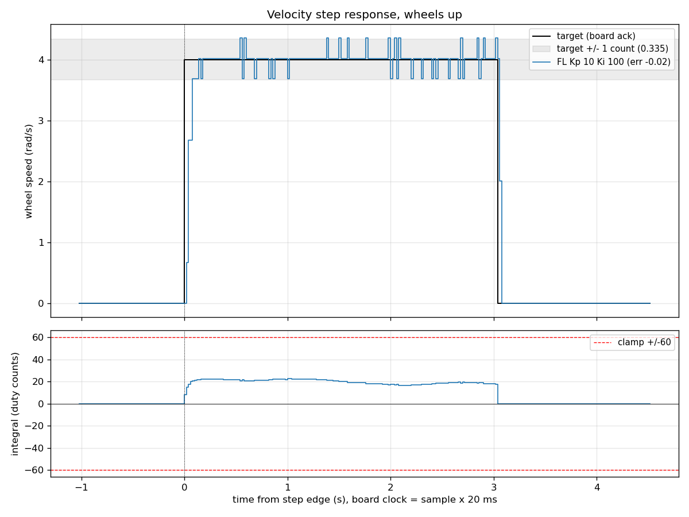
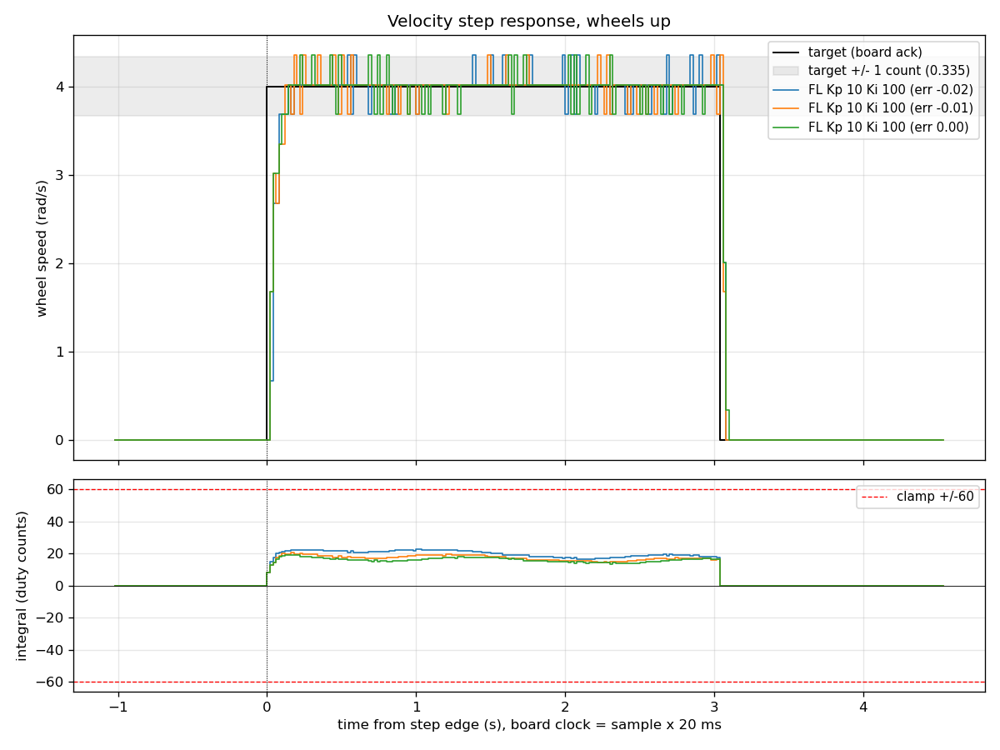

# Step 7: Nucleo serial bridge on the Raspberry Pi 5 (2026-10-30 and 2026-11-01)

This bench work brought up `nucleo_bridge`, the ROS 2 node that owns the
serial link between the Raspberry Pi 5 and the Nucleo motor controller. It
is the first time ROS 2 drives the real motors. The node takes wheel-speed
commands from ROS 2, sends them to the firmware's per-wheel PI loops, and
publishes the measured wheel speeds on `/wheel_speeds`, the same contract
`joint_state_adapter` fills in the Gazebo simulation, so `mecanum_odometry`
runs unchanged on the real robot. The work ran over two days, with the
robot on a stand and wheels up: on 2026-10-30, a USB-path check with the
existing logger (D1) and six tests of the teaching version of the node
(D2); on 2026-11-01, checks B1 to B6 on the professional version. Result:
every test and check passed, and `colcon test` on the Pi reports 43 tests
with 0 failures.

Code: [`nucleo_bridge.py`](../../src/mecanum_control/mecanum_control/nucleo_bridge.py),
[`test_nucleo_bridge.py`](../../src/mecanum_control/test/test_nucleo_bridge.py),
[`nucleo_bridge.yaml`](../../src/mecanum_bringup/config/nucleo_bridge.yaml).
Commits: [a6f1a57](https://github.com/KamalaIssack/Mecanum-wheel-mobile-robot-project/commit/a6f1a57)
(code) and [ef03a2f](https://github.com/KamalaIssack/Mecanum-wheel-mobile-robot-project/commit/ef03a2f)
(data).

## Setup

- Dates: 2026-10-30 and 2026-11-01. Robot on its stand, all four wheels off
  the ground.
- Host: Raspberry Pi 5 running Ubuntu 24.04 LTS and ROS 2 Jazzy, powered from
  the official 27 W supply (not yet from Buck B), developed over VS Code
  Remote-SSH.
- Link: the Nucleo is connected by USB to the Pi. The serial port is the
  Nucleo's ST-Link virtual COM port (USART2), `/dev/ttyACM0`, at
  115200 8N1.
- Power: 3S LiPo through the XT60 for motor power. Cell alarm on the balance
  lead, UT33D+ multimeter as ground truth (readings under Battery below).
- Firmware: commit 47b3292 (PI wheel velocity control), the latest firmware
  commit. Gains Kp 10 / Ki 100, locked on 2026-10-19. Tools: commit 70b130b
  (`step_logger.py` / `plot_step.py`).
- Bridge: the teaching version of the node (commit 02b6cb6) for the D2
  tests, and the professional version (commit a6f1a57) for checks B1 to B6.
  In both cases the bridge was driven by publishing `/wheel_speeds_cmd`
  directly with `ros2 topic pub`. `mecanum_kinematics` still publishes on
  `/wheel_speeds`, and nothing connects it to `/wheel_speeds_cmd` yet; that
  remap belongs to the hardware launch file, the next step.

## Protocol and handshake

The node speaks the firmware's existing newline-framed ASCII protocol:

| Direction | Line | Use in the bridge |
|-----------|------|-------------------|
| Pi -> Nucleo | `C,fl,fr,rl,rr` | Wheel targets in rad/s, re-sent every `heartbeat_period` (0.1 s). This heartbeat feeds the firmware's 300 ms watchdog. |
| Pi -> Nucleo | `E,1` / `E,0` | Arm / disarm. |
| Pi -> Nucleo | `K,<kp>` / `I,<ki>` | Gains, accepted only while disarmed. |
| Nucleo -> Pi | `V,fl,fr,rl,rr` | Measured wheel speeds at 50 Hz, each published on `/wheel_speeds`. |
| Nucleo -> Pi | `A,...` | Acks. A missing velocity ack for more than `ack_timeout` (0.5 s) raises one warning. |
| Nucleo -> Pi | `S,ARMED` / `S,DISARMED` / `S,TIMEOUT` | Board state, published on `/nucleo_status` (`std_msgs/String`, TRANSIENT_LOCAL durability, so late subscribers such as Foxglove still receive the current state). |
| Nucleo -> Pi | `D,...` | Integral telemetry; not used by the bridge. |

Start-up handshake, each step confirmed by its reply:

1. Wait 0.2 s for the port to settle, then send a bare newline. It ends any
   partial line left in the firmware's receive buffer, which would otherwise
   swallow the first `E,0`.
2. `E,0`, expecting `S,DISARMED`. If that goes unanswered, the node logs a
   warning and retries once.
3. `K,10.00`, expecting `A,K,10.00`, then `I,100.00`, expecting `A,I,100.00`.
4. `E,1`, expecting `S,ARMED`.

If any reply is missing, the node refuses to arm, sends `C,0,0,0,0` and
`E,0`, and exits, so the board is never left armed after a failure.

While running, a command older than `cmd_timeout` (0.5 s) is replaced by
zeros. The board stays armed, so a dead upstream node stops the robot
instead of the heartbeat hiding it. The change per heartbeat is limited by
`max_accel` (20 rad/s^2, which is 2.0 rad/s per `C` line), and speeds are
clamped to `max_wheel_speed` (41.9 rad/s), just under the firmware's
42 rad/s rejection limit. This is the acceleration limit on commanded
wheel velocities that the 2026-10-19 write-up called for to soften stops.

On exit the node sends `C,0,0,0,0` then `E,0`. A lost serial port ends the
node with one ERROR line and exit code 1, with no traceback.

The parsing, ramp and stale-command logic are pure functions, covered by
25 pytest cases in `test_nucleo_bridge.py`. Parameters load from
`mecanum_bringup/config/nucleo_bridge.yaml`.

## Verification: USB path from the Pi (D1, 2026-10-30)

Before any ROS 2 code touched the board, the Pi-to-Nucleo USB path was
proven with the existing, trusted host tool. `step_logger.py` ran on the Pi
over `/dev/ttyACM0`: three FL runs at Kp 10 / Ki 100, step 0 -> 4 -> 0 rad/s
(1 s settle, 3 s hold, 1.5 s post). Summary from `plot_step.py --no-show`
(metric definitions as in the
[2026-10-19 write-up](../../../firmware/stm32/nucleo_f446re/bench/2026-10-19_pi_control/)):

| Run | File | Rows | mean | error | jitter | over | t63 (s) | t_in (s) | I_ss | gaps |
|-----|------|------|------|-------|--------|------|---------|----------|------|------|
| 1 (cold) | `step_fl_kp10_ki100_20261030-100439.csv` | 278 | 4.02 | -0.02 | 0.167 | 1 | 0.04 | 0.28 | +18.2 | 0 |
| 2 | `step_fl_kp10_ki100_20261030-101141.csv` | 279 | 4.01 | -0.01 | 0.138 | 1 | 0.04 | 2.62 | +16.1 | 0 |
| 3 | `step_fl_kp10_ki100_20261030-101955.csv` | 279 | 4.00 | 0.00 | 0.162 | 1 | 0.04 | 0.26 | +15.3 | 0 |

Reference, FL on 2026-10-19 from the Mac: mean 4.00, error 0.00, jitter
0.142, t_in 0.24, I_ss +11.3.

The table was regenerated from the committed CSVs with the committed
plotter, and it matches the bench output.

How to read it:

- **Error and gaps.** The error is within +/-0.05 on every run, and gaps = 0,
  so the Pi's USB path dropped no telemetry.
- **over = 1** is encoder quantization (one count is about 0.335 rad/s at
  50 Hz), not real overshoot.
- **An error of -0.02** is about one standard error of the mean
  (0.167 / sqrt(75), about 0.02), so it is noise. The minus sign means
  slightly faster than commanded.
- **Row counts.** 278 and 279 rows against a predicted 278.6 (the logger's
  nominal estimate is about 275). This is the Nucleo's internal HSI clock
  running about 1.3% fast. The loop regulates the board's own reading, so
  this table cannot show that error: the real wheel speed is about
  4.05 rad/s.
- **I_ss trend, 18.2 -> 16.1 -> 15.3.** Each drop is smaller than the last
  (2.1, then 0.8), so it is levelling off around 14 to 15, not returning to
  11. Roughly 3 counts are cold-start friction and about 4 counts are a
  persistent change since 2026-10-19 (cause unknown). That is well inside
  the +/-60 integral range. Watch it.
- **Run 2's t_in of 2.62 s** is reported as measured; the other runs give
  0.28 and 0.26 s. In the CSV, the 0.2 s average entered the +/-0.1 band at
  0.28 s, as on the other runs. Between 2.42 and 2.60 s every third reading
  was 11 counts (3.69 rad/s) instead of 12 (4.02), so the 10-sample window
  ending at 2.60 s held four 11-count readings and averaged 3.888 rad/s,
  0.012 outside the band. It was back inside on the next sample (2.62 s)
  and stayed there, and the plotter counts t_in from that last entry. The
  integral was climbing over the same stretch (14.7 to 16.9). The cause of
  that stretch is not known.

## Results

### D2: six bridge tests with motor power (2026-10-30, teaching version)

| # | Test | Result |
|---|------|--------|
| 1 | Start with motor power: handshake, armed, wheels held | Pass |
| 2 | One wheel: FL forward, measured mean 4.00 rad/s over 257 samples | Pass |
| 3 | Four patterns: forward, strafe left, rotate CCW, diagonal | Pass, all match the sign table |
| 4 | Stale command: stop within about 0.7 s, stays armed, no `S,TIMEOUT` | Pass |
| 5 | Clean exit (Ctrl+C): immediate stop, LD2 off | Pass |
| 6 | `kill -9`: watchdog stop, LD2 off, latch holds | Pass |

About 0.7 s for test 4 is consistent with the design: the 0.5 s
`cmd_timeout`, plus ramping 4.0 rad/s down at 2.0 rad/s per 0.1 s line.

### B1 to B6: checks on the professional version (2026-11-01, commit a6f1a57)

| # | Check | Result |
|---|-------|--------|
| B1 | Start with the YAML parameters file | Pass: armed, no WARN |
| B2 | Read `/nucleo_status` | Pass: `ARMED` delivered to a late subscriber |
| B3 | One wheel | Pass: FL forward, mean 4.00 rad/s over 516 samples, no ack warning |
| B4 | Ctrl+C on the bridge | Pass: immediate stop, LD2 off, exit 0 |
| B5 | `kill -9` | Pass: watchdog stop, latch held, restart with no WARN |
| B6 | Pull the USB cable (wheels still, XT60 out) | Pass: one ERROR line (`serial link lost ... [Errno 19] No such device`), exit 1, no traceback |

`colcon test` on the Pi: 43 tests, 0 failures.

### `plots/step_fl_kp10_ki100_20261030-100439.png`

D1 run 1, the cold first run of the day, logged on the Pi. The top panel is
FL speed against the acknowledged target, with a grey +/-1 count band; the
bottom panel is the integral in duty counts against the +/-60 clamp. After
the step edge the speed climbs through 0.67, 2.68 and 3.69 rad/s and reaches
4.02 rad/s (12 counts) about 0.1 s later. Through the hold it alternates
between 12 and 11 counts, with occasional single 13-count readings
(4.36 rad/s), which is the over = 1 in the table. At the stop the speed
drops to 0 within three samples. The integral rises to a peak of 22.5 within
about 0.2 s, eases to about 16.5 around the middle of the hold, ends at 18.0
and is reset to 0 at the stop. It stays far from the clamp. This is the
same shape as FL on 2026-10-19 from the Mac, with the integral sitting
higher.

### `plots/fl_kp10_ki100.png`

All three D1 runs overlaid, with t = 0 at each run's own acknowledged step
edge. The speed traces are indistinguishable at this scale: the same rise,
the same 11/12-count alternation through the hold, and the same stop. The
bottom panel shows the integral trend from the table: run 1 (blue) sits
highest through most of the hold, and runs 2 (orange) and 3 (green) sit
lower and close together, peaking at 20.4 and 19.1. Run 2's late t_in is
not visible here; it comes from the one-sample band exit at 2.60 s
described under Verification.

## Battery

| When | Multimeter | Cells |
|------|-----------|-------|
| 2026-10-30 morning | 12.52 V | 4.15 / 4.15 / 4.18 |
| 2026-10-30 after D1 + D2 | 12.44 V | 4.13 / 4.13 / 4.15 |
| 2026-11-01 before B1 (rested) | 12.65 V | 4.20 / 4.20 / 4.22 |
| 2026-11-01 after B6 | 12.60 V | 4.18 / 4.19 / 4.21 |

## Challenges and how they were handled

- **The first `E,0` of a session was lost once.** Working hypothesis: a
  partial line was left in the Nucleo's receive buffer after the previous
  session ended with `kill -9`. Later opens after a clean close did not lose
  it. Handled in the professional node with a bare newline before the first
  `E,0`, plus one logged retry. Watch for the WARN line
  (`first E,0 unanswered, retrying once`).
- **The Nucleo clock runs about 1.3% fast** (internal HSI), visible in the
  logger row counts in D1. Fixing it (HSI to HSE bypass) is deliberately
  parked, not forgotten.
- **FL's settled integral is 15 to 18,** against 11 on 2026-10-19 (see the
  I_ss reading under Verification). Being watched.
- **The Nucleo is powered only through the Pi's USB.** B6 showed this: all
  of its LEDs went off when the cable was pulled. Before self-powered
  running, a decision is needed on keeping the motor drivers safe if that
  link drops: power the Nucleo from Buck A as well, or confirm the BTS7960
  inputs are pulled low when undriven. This is an open item for the
  mounting / self-powered step.
- **Open design question for the next step:** whether the bridge should
  also publish `/joint_states`, so the wheel frames appear in TF.

## Data file index

| File | Contents |
|------|----------|
| `data/step_fl_kp10_ki100_20261030-100439.csv` | D1 run 1 (cold): FL, Kp 10 / Ki 100, 0 -> 4 -> 0 rad/s, logged on the Pi. |
| `data/step_fl_kp10_ki100_20261030-101141.csv` | D1 run 2: same profile; the run with t_in 2.62 s. |
| `data/step_fl_kp10_ki100_20261030-101955.csv` | D1 run 3: same profile. |
| `plots/step_fl_kp10_ki100_20261030-100439.png` | Run 1 alone: speed and integral. |
| `plots/fl_kp10_ki100.png` | All three D1 runs overlaid. |

Only the D1 logger runs have data files here. The D2 tests and checks B1
to B6 are recorded as the results in the tables above.

## Conclusion and next step

The bridge works on hardware. The Pi's USB path drops no telemetry and
reproduces the 2026-10-19 tracking (error within +/-0.05 rad/s on all three
runs), ROS 2 commands move all four wheels in every pattern tested, and
every stop path was exercised: a stale command, Ctrl+C, `kill -9` (with the
firmware watchdog as backup) and a pulled USB cable. The next step is the
hardware launch file that remaps `/cmd_vel` -> `mecanum_kinematics` ->
`nucleo_bridge` -> `mecanum_odometry` on the real robot, giving real
odometry, then Deck 2 mounting and self-powered running.
