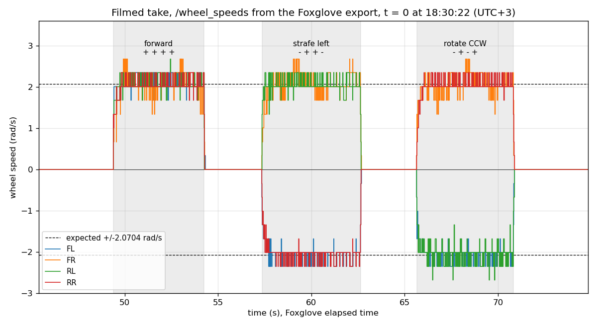
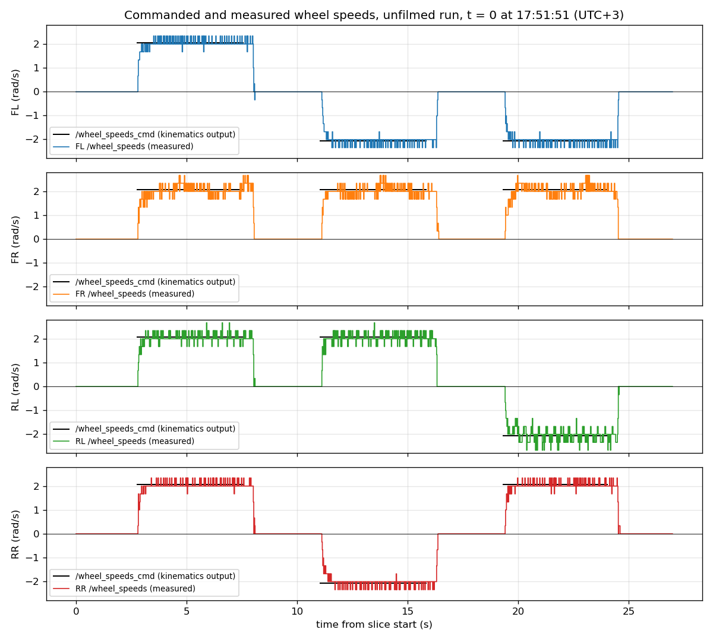
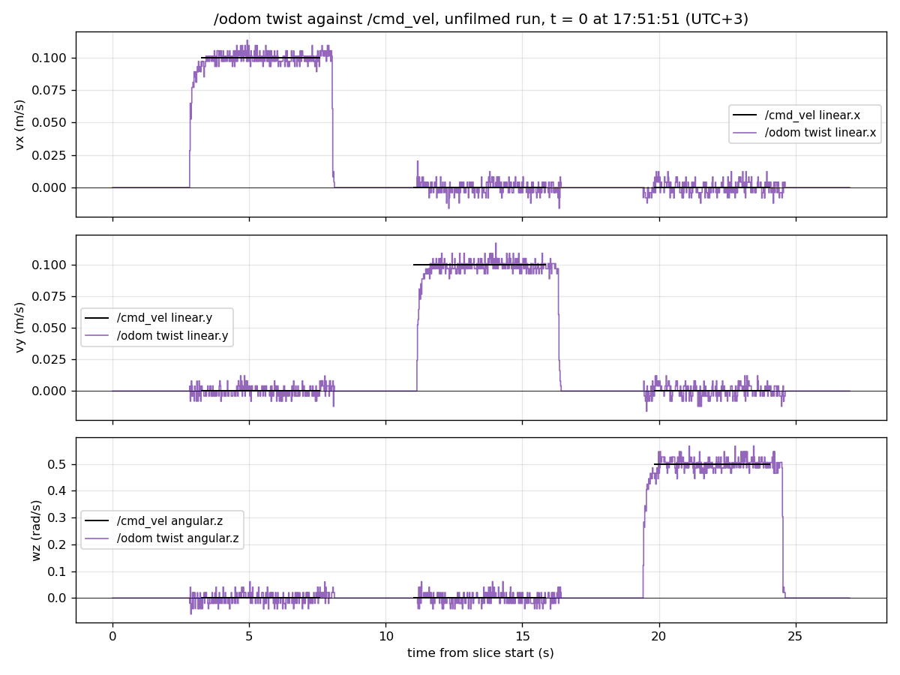
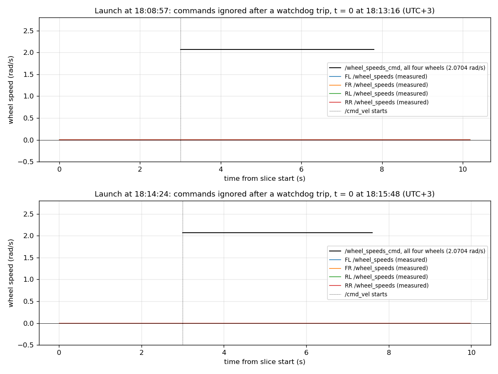

# Session E: ROS 2 drives the real robot through hardware.launch.py (2026-11-18)

This bench session tested the last link between ROS 2 and the motors.
`nucleo_bridge` now also publishes `/joint_states`, and
`hardware.launch.py` starts the five-node hardware stack, so a `/cmd_vel`
command goes through `mecanum_kinematics` and `nucleo_bridge` to the
per-wheel PI loops on the Nucleo, and the measured wheel speeds come back
as `/odom`. The robot was on its stand with all four wheels up. Two checks
were run: E2, `/joint_states` on hardware, and E4, the launch file on
hardware, first with the battery off and then driving forward, strafe left
and rotate CCW. Result: every motion gave the right wheel signs and an
`/odom` velocity within 0.1% of the command, and every stop path worked,
but in 2 of 9 launches the Nucleo's command watchdog tripped shortly after
arming (fail-safe, under investigation).

Code: [`hardware.launch.py`](../../src/mecanum_bringup/launch/hardware.launch.py),
[`nucleo_bridge.py`](../../src/mecanum_control/mecanum_control/nucleo_bridge.py),
[`nucleo_bridge.yaml`](../../src/mecanum_bringup/config/nucleo_bridge.yaml).
Commits: [2889943](https://github.com/KamalaIssack/Mecanum-wheel-mobile-robot-project/commit/2889943)
(`nucleo_bridge` publishes `/joint_states`),
[e362f75](https://github.com/KamalaIssack/Mecanum-wheel-mobile-robot-project/commit/e362f75)
(`hardware.launch.py`) and
[4eb6283](https://github.com/KamalaIssack/Mecanum-wheel-mobile-robot-project/commit/4eb6283)
(clean SIGINT shutdown in kinematics, odometry and joint_state_adapter).
They were tested on the branch `feat/session-e` at 4eb6283 and
fast-forward merged to main on 2026-11-19.

## Setup

- Date: 2026-11-18. Robot on its stand, all four wheels off the ground.
  Clock times are local time (UTC+3).
- Host: Raspberry Pi 5 running Ubuntu 24.04 LTS and ROS 2 Jazzy, powered
  from the official 27 W supply.
- Link: Nucleo-F446RE on the Pi's USB, `/dev/ttyACM0`, 115200 8N1.
- Power: 3S LiPo through the XT60 for motor power. Cell alarm on the
  balance lead, UT33D+ multimeter as ground truth (readings under Battery
  below).
- Firmware: commit 47b3292 (per-wheel PI), gains Kp 10 / Ki 100.
- Code under test: `feat/session-e` at 4eb6283 (the three commits above).
  `colcon test` on the Pi: 47 tests, 0 failures, 2 skipped.
- Recording: a rosbag2 bag of `/cmd_vel`, `/wheel_speeds_cmd`,
  `/wheel_speeds` and `/odom` ran from 17:40 to 18:25 and covers 5 of the
  9 launches, including an unfilmed run of all three motions at 17:51 and
  both watchdog trips. It does not cover the filmed take at about 18:31;
  the data for that take is a Foxglove plot export. Only short slices of
  the bag are committed (see Data file index).

## E2 verification: `/joint_states` on hardware

The bridge was run alone, with the XT60 unplugged and the board armed
(LD2 on).

- Rolling each wheel forward by hand gave a positive velocity and a
  climbing position in that wheel's own `/joint_states` slot, with no
  crosstalk between wheels.
- In Foxglove's 3D view (with `robot_state_publisher` and
  `foxglove_bridge` started by hand), all four wheel frames turned the same
  way as the real wheels.
- Ctrl-C on the bridge stopped it cleanly, and LD2 went off.

The encoder supply (white) wires are spliced under heatshrink into one
lead on morpho CN7 pin 16 (+3V3), the same net as the drivers' CN6 pin 4.

## E4 checks with the battery off

`ros2 launch mecanum_bringup hardware.launch.py` with the XT60 unplugged:

| Check | Result |
|-------|--------|
| Nodes | Five: `mecanum_kinematics`, `nucleo_bridge`, `mecanum_odometry`, `robot_state_publisher`, `foxglove_bridge`. No `joint_state_publisher`. |
| Rates | `/wheel_speeds` and `/joint_states` both about 50.6 Hz. The Nucleo's internal HSI clock runs about 1.2 to 1.3% fast. The bag gives 50.62 to 50.65 Hz per launch. |
| Remap | `ros2 topic info /wheel_speeds` shows `nucleo_bridge` as the only publisher, which proves the kinematics output is remapped to `/wheel_speeds_cmd` on hardware. |
| TF tree | `view_frames`: `odom` -> `base_link` at 50.0 Hz (Pi clock), then the four wheel links, `lidar_link` and `imu_link`. |
| Wheel frames | About 16.9 Hz. `robot_state_publisher`'s `publish_frequency` defaults to 20 Hz, so it uses about every third `/joint_states` message. Nothing downstream uses the wheel frames, so this is left as is. |

## E4 motions

Wheels up, on battery. Each motion was sent with `ros2 topic pub` on
`/cmd_vel` at 0.1 m/s or 0.5 rad/s. The expected wheel speed is the same
for all three motions: 0.1 / 0.0483 = 2.0704 rad/s (the 0.5 rad/s rotation
gives the same value because lx + ly = 0.2 m).

The means below are from the unfilmed run at 17:51 (`data/run_1751/`),
averaged from 0.8 s after the first `/cmd_vel` to 0.3 s before the last
(`tools/analyse_bag.py`):

| Motion | Commanded | Wheel signs (FL FR RL RR) | FL | FR | RL | RR | `/odom` |
|--------|-----------|---------------------------|----|----|----|----|---------|
| Forward | vx 0.1 m/s | + + + + | +2.0816 | +2.0736 | +2.0668 | +2.0708 | vx 0.10009 m/s |
| Strafe left | vy 0.1 m/s | - + + - | -2.0773 | +2.0505 | +2.0688 | -2.0773 | vy 0.09998 m/s |
| Rotate CCW | wz 0.5 rad/s | - + - + | -2.0705 | +2.0689 | -2.0824 | +2.0684 | wz 0.50031 rad/s |

All three sign patterns match the locked sign table. Every wheel mean is
within 0.02 rad/s (1%) of 2.0704, and every `/odom` mean is within 0.1%
of the command. Single readings from `ros2 topic echo /odom` on the bench
agreed: vx 0.09997 m/s, vy 0.09996 m/s and wz 0.5003 rad/s.

Single `/wheel_speeds` readings step between about 2.01 and 2.35 rad/s.
This is encoder quantisation, not controller oscillation (see the first
plot under Results).

Odometry has no reset service yet (`ResetOdometry.srv` has no server), so
odometry was reset by relaunching.

## Stop paths

| Stop | Result |
|------|--------|
| Stop the `/cmd_vel` publisher | Wheels stopped after the bridge's 0.5 s `cmd_timeout`. The board stayed ARMED. |
| Ctrl-C of the launch during the rotation | Wheels stopped at once, LD2 went off, and all nodes exited cleanly. `on_exit=Shutdown` on `nucleo_bridge` stops the whole launch. |
| USB host controller crash (unplanned, see Challenges) | The bridge exited on the missing `/dev/ttyACM0`, and the whole launch stopped as designed. |
| Watchdog trip (unplanned, see Challenges) | The board disarmed and the latch held, so the motors stayed off. |

## Results

### `plots/take1_wheel_speeds.png`

The filmed take, from the Foxglove plot export (`tools/analyse_csv.py`).
The export covers 264 s; the motions are at 49 to 71 s, and the plot shows
only that part. Each motion is shaded and labelled with its name and the
sign pattern found in the data. The dashed lines are the expected
+/-2.0704 rad/s. Means over the steady part of each motion:

| Motion | Time (s) | FL | FR | RL | RR |
|--------|----------|----|----|----|----|
| Forward | 49.4 to 54.3 | +2.0772 | +2.0758 | +2.0754 | +2.0701 |
| Strafe left | 57.4 to 62.6 | -2.0739 | +2.0907 | +2.0675 | -2.0738 |
| Rotate CCW | 65.7 to 70.8 | -2.0690 | +2.0407 | -2.0761 | +2.0754 |

What to notice: the readings never sit on the dashed line. They jump
between about 2.01 and 2.35 rad/s, with occasional 2.68 and 1.68. The
firmware measures speed as encoder counts per 20 ms tick, and one count is
2 x pi / 937.2 / 0.02 = 0.335 rad/s. At 2.0704 rad/s a wheel turns 6.18
counts per tick, so a single reading can only be 6 counts (2.01 rad/s) or
7 counts (2.35 rad/s). The averages hold 2.07. This is quantisation, not
oscillation of the controller.

The export has 13365 rows per wheel over 263.7 s, which is 50.68 Hz. The
timestamps are receive times, in whole milliseconds, and the
messages arrive in bursts, so some rows share a timestamp. Each row is a
separate message, and every row is used.

### `plots/run_1751_cmd_vs_measured.png`

The unfilmed run at 17:51, one panel per wheel: `/wheel_speeds_cmd` (the
kinematics output, black) against `/wheel_speeds` (measured). The bag
records the command before the bridge ramps it. The bridge limits the
change to `max_accel` x `heartbeat_period` = 20 rad/s^2 x 0.1 s =
2.0 rad/s per `C` line, so 0 to 2.07 rad/s takes two heartbeats, about
0.2 s. The measured speed follows: the wheels start moving within 0.1 s of the
first `/wheel_speeds_cmd`, and all four first read 2.01 rad/s or more 0.35
to 0.41 s after it (0.63 s in the rotation). Through each hold the
PI loop keeps every wheel on 2.07 rad/s on average. At the end the wheels
read zero 0.63 to 0.67 s after the last `/cmd_vel`: the 0.5 s
`cmd_timeout`, then the ramp down.

### `plots/run_1751_odom.png`

The same run, `/odom` twist (vx, vy, wz) against the commanded `/cmd_vel`.
Each motion shows up only on its own axis. The other two average within
0.0014 of zero; single readings scatter by up to 0.016 m/s and 0.061 rad/s,
from the same encoder quantisation.

Two things to notice:

- In the forward and rotate segments, `/odom` rises about 0.5 s before the
  black `/cmd_vel` line starts. The bag recorder missed the first 5
  `/cmd_vel` messages of those segments, while kinematics received them
  (see challenge 8).
- `/odom` starts to fall about 0.5 s after the last `/cmd_vel`, and is zero
  0.65 to 0.68 s after it. The publisher stopped without sending a zero,
  and the bridge's 0.5 s `cmd_timeout` then replaced the stale command with
  zeros. This is the stale-command stop path, visible in the data.

### `plots/watchdog_trips.png`

The two launches in which the watchdog tripped, one panel each. All four
wheels are commanded the same 2.0704 rad/s (a forward motion), so one
black line stands for all four. The dotted line marks where `/cmd_vel`
starts. Every wheel stays at 0 rad/s for the whole command. The trip
itself is not in the bag (`/nucleo_status` was not recorded). Per the
launch logs, the watchdog fired 0.86 s after arming in the launch at
18:08:57 and 2.86 s after arming in the launch at 18:14:24, minutes before
these commands. After the trip the board stays disarmed (latched), while
the rest of the stack keeps running, so the commands have no effect.

## Demo video

Foxglove during the filmed take: the URDF is placed by `/odom`,
dead-reckoned from the real encoders, so the model drives across the grid
while the robot sits on its stand.

https://github.com/user-attachments/assets/3aeae32b-9888-4edf-9679-113e11e23771

## Battery

| When | Multimeter | Cells |
|------|-----------|-------|
| 2026-11-18 before | 12.63 V | 4.19 / 4.19 / 4.21 |
| 2026-11-18 after | 12.43 V | 4.12 / 4.12 / 4.15 |

## Challenges and how they were handled

1. **Plugging in the XT60 once crashed the Pi 5's USB host controller**
   (`dmesg`: "HC died"). The bridge then exited on the missing
   `/dev/ttyACM0`, and the whole launch stopped as designed. A reboot
   cleared it, and a second plug-in did not repeat it.
2. **In 2 of 9 launches the Nucleo's 300 ms command watchdog fired**, 0.86 s
   and 2.86 s after arming (launches at 18:08:57 and 18:14:24): `S,TIMEOUT`,
   latched disarm. The rest of the stack kept running, so commands had no
   effect (see `plots/watchdog_trips.png`). `dmesg` showed no USB events.
   A code review on 2026-11-19 ruled out the firmware side: receive is
   interrupt-driven into a 128-byte ring buffer, the error callback re-arms
   reception after an overrun, there is at most about 9 ms of main-loop
   work before a `C` line is parsed, and the firmware acks `C` lines even
   while disarmed, so the bridge saw no ack warning. Conclusion: on the Pi,
   `nucleo_bridge`'s single-threaded executor did not run `send_heartbeat`
   for about 200 ms or more. Candidates, not yet distinguished: a blocking
   `ser.write()` (no `write_timeout`), `publish()` waiting inside DDS while
   other nodes and Foxglove are discovered, or a step in the system clock
   (rclpy timers run on ROS time, which is system time). The failure is
   fail-safe: the motors are disarmed and the latch holds. Next step:
   instrument the heartbeat on a branch `fix/bridge-heartbeat` and catch it
   with repeated launches on the next bench day. Main was merged anyway,
   because the failure is fail-safe and every feature in the three commits
   was verified.
3. **The bag recorder was left running** when its terminal was closed
   (17:40 to 18:25), and was stopped later with `kill -INT`, so the bag was
   finalised correctly. As a result it holds an earlier unfilmed run and
   the failed launches, but not the filmed take. The Foxglove CSV is the
   only data for the filmed take.
4. **The bag is 92 MB**, mostly because every `/odom` message carries two
   36-element covariance arrays, at 50 Hz, for 45 minutes. Only short
   slices are committed.
5. **Wheel frames publish at about 16.9 Hz** (see E4 checks with the
   battery off). Left as is, because nothing downstream uses them.
6. **`robot_state_publisher` logs a KDL warning** that the root link
   `base_link` has an inertia, which KDL does not support. Harmless here.
7. **Starting `robot_state_publisher` by hand with
   `-p robot_description:=...` fails.** rcl parses `-p` values as YAML, and
   the URDF comments contain `: ` and an apostrophe. A params file written
   with `yaml.safe_dump` works. `hardware.launch.py` is not affected.
8. **DDS discovery dropped the first messages of several motions.** Each
   motion was sent with a fresh `ros2 topic pub`, which starts a new node.
   DDS discovery matched that new publisher to each subscriber at a
   slightly different moment, and messages sent before a subscriber was
   matched never reached it (the topics are volatile and keep no history).
   The data shows it in both directions: kinematics missed the first 12
   `/cmd_vel` messages (1.2 s) at 18:05:45 and the first 5 at 18:15:59; the
   bag recorder missed the first 5, 5 and 1 at 17:51:54, 17:52:10 and
   18:05:35. The missing messages were lost, not delayed: the ones that did
   arrive were spaced about 100 ms apart, with no catch-up burst. The low
   means (about 1.5 rad/s) of the 18:05:45 strafe come from the same
   effect: the averaging window included about 0.4 s before the wheels
   started. This comes from the test method, not the robot code: a single
   long-lived publisher (a script, a joystick node or Nav2) is matched once
   at start-up, so the next bench session will send all motions from one
   node. It is not the cause of the watchdog trips (the bridge's heartbeat
   runs on its own timer and does not depend on incoming messages), but it
   is direct evidence that DDS discovery affects timing on the Pi, which
   is one of the watchdog candidates.

## Data file index

| File | Contents |
|------|----------|
| `data/take1_wheel_speeds_foxglove.csv` | Filmed take, Foxglove Plot-panel export of `/wheel_speeds`, long format (`elapsed time`, `timestamp`, `topic`, `value`), 264 s, four wheels. |
| `data/run_1751/` | MCAP bag slice, 17:51:51 to 17:52:18: the unfilmed run of all three motions. All four topics. |
| `data/watchdog_trip_1813/` | MCAP bag slice, 18:13:16.7 to 18:13:26.9: a forward command ignored after the watchdog trip in the launch at 18:08:57. |
| `data/watchdog_trip_1815/` | MCAP bag slice, 18:15:48.0 to 18:15:58.0: a forward command ignored after the watchdog trip in the launch at 18:14:24. |
| `plots/take1_wheel_speeds.png` | Filmed take, the three motions. |
| `plots/run_1751_cmd_vs_measured.png` | Unfilmed run, `/wheel_speeds_cmd` against `/wheel_speeds`, per wheel. |
| `plots/run_1751_odom.png` | Unfilmed run, `/odom` twist against `/cmd_vel`. |
| `plots/watchdog_trips.png` | Both watchdog trips, command against measured. |
| `tools/analyse_bag.py` | Finds launches, motion segments (with wheel and `/odom` means) and watchdog-trip signatures in a bag. |
| `tools/analyse_csv.py` | Finds the motion segments in the Foxglove CSV and prints their means and the sample rate. |
| `tools/slice_bag.py` | Copies a time window of a bag into a new MCAP bag, raw messages, all topics. The docstring holds the exact commands for the three slices. |
| `tools/make_plots.py` | Regenerates every plot from the files in `data/` only. |

The bag tools need ROS 2 Jazzy and the workspace overlay sourced (for
`mecanum_interfaces/msg/WheelSpeeds`). The demo videos are not stored in
the repository.

## Conclusion and next step

ROS 2 now drives the real robot end to end: `hardware.launch.py` takes
`/cmd_vel` through `mecanum_kinematics` and `nucleo_bridge` to the
Nucleo's per-wheel PI loops, and `/odom` comes back from the real encoders
within 0.1% of the command, with the right wheel signs for forward, strafe
left and rotate CCW. Every stop path tested worked. The open problem is the
intermittent watchdog trip after arming, which is fail-safe. The next step
is the `fix/bridge-heartbeat` investigation: instrument the bridge's
heartbeat and catch the stall with repeated launches. After that come
Deck 2 mounting and self-powered running.
